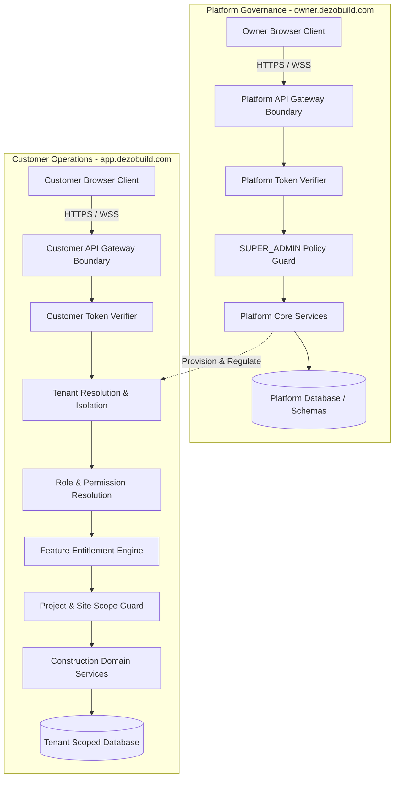
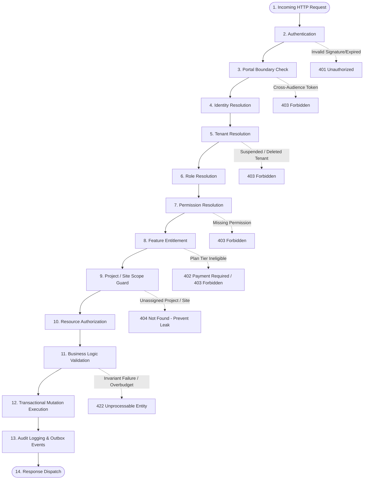

# DEZOBUILD — Authoritative Backend System Architecture

**Phase**: Backend Architecture Definition  
**Mode**: Forensic / Contract-First / Pre-Implementation  
**Status**: Authoritative Blueprint (Pre-Code Gate)  

---

## 1. High-Level System Architecture

DEZOBUILD is a multi-tenant construction management operating system structured into two strictly partitioned application domains:
1. **Platform Owner Governance Hub** (`owner.dezobuild.com`): SaaS operations, tenant provisioning, plan definitions, subscription entitlements, platform telemetry, and global security audit.
2. **Customer Tenant Application** (`app.dezobuild.com`): Multi-tenant construction execution environment (projects, WBS, DPRs, indents, POs, GRNs, expenses, payments, labour muster, machinery, documents).



---

## 2. Platform System vs Customer System

### Architectural Separation
- **Host / Network Boundary**: `owner.dezobuild.com` and `app.dezobuild.com` target isolated API route trees (`/platform/*` vs `/api/v1/*`).
- **Token Audience**: Platform JWTs declare `aud: "owner.dezobuild.com"`; customer JWTs declare `aud: "app.dezobuild.com"`. Cross-audience presentation fails unconditionally at the API gateway.
- **Data Boundary**: Customer operations are strictly isolated by `company_id` / `tenant_id`. Platform administrative operations govern tenant metadata, subscription status, and platform health snapshots without intermingling with tenant construction documents or financial ledgers.

### Why `SUPER_ADMIN` and `COMPANY_OWNER` are Fundamentally Distinct

```text
┌──────────────────────────────────────────────┬──────────────────────────────────────────────┐
│ PLATFORM SUPER_ADMIN                         │ TENANT COMPANY_OWNER                         │
├──────────────────────────────────────────────┼──────────────────────────────────────────────┤
│ Lives in Platform Registry (PlatformUser)    │ Lives in Tenant Directory (User)             │
│ Authenticates against owner.dezobuild.com    │ Authenticates against app.dezobuild.com      │
│ Governs SaaS infrastructure & billing        │ Governs corporate construction business      │
│ Has NO company_id / tenant_id                │ Bound strictly to exactly one company_id     │
│ Cannot approve project POs or sign DPRs      │ Approves company-wide POs, DPRs, RA bills    │
│ Cannot be invited as a site engineer         │ Can assign roles and invite site personnel   │
│ Cannot access tenant data without audit log  │ Full legal ownership of tenant data          │
└──────────────────────────────────────────────┴──────────────────────────────────────────────┘
```

> [!CRITICAL]
> `SUPER_ADMIN` is **NEVER** treated as an ordinary tenant user with bypass privileges. A platform operator accessing a tenant for support must use an explicitly time-bounded, cryptographically signed, and audited **Impersonation / Support Ticket** mechanism that generates immutable audit trails on both platform and tenant ledgers.

---

## 3. Authoritative Request Security Pipeline

Every incoming customer API request must pass through an immutable 14-stage security and execution pipeline. Short-circuiting or skipping any stage is architecturally prohibited.



### Authoritative Pipeline Stage Definitions

| Stage | Responsibility | Primary Input | Primary Output | Authoritative Source | Failure Code | Security Risk Mitigated |
| :--- | :--- | :--- | :--- | :--- | :--- | :--- |
| **1. Request** | TLS termination, IP & headers extraction, Rate limiting | HTTP Raw Stream | Parsed HTTP Request | Gateway / Reverse Proxy | `429 Too Many Requests` | DoS, brute force |
| **2. Authentication** | Cryptographic verification of JWT / session cookie | Bearer Token | `claims` (sub, aud, exp, ver) | Platform Auth / KMS | `401 Unauthorized` | Forged / expired tokens |
| **3. Portal Boundary** | Enforce domain-audience alignment | Token `aud`, Request Host | Validated Boundary Flag | Gateway Routing Config | `403 Forbidden` | Platform ↔ Customer cross-login |
| **4. Identity Resolution** | Resolve active User record, verify account status | `claims.sub` | `User` entity (active, MFA status) | User Repository | `401 Unauthorized` | Terminated employee token reuse |
| **5. Tenant Resolution** | Resolve company context, verify tenant active state | `claims.tenant_id` | `Tenant` entity (status, tier) | Tenant Repository | `403 Forbidden` | Suspended / delinquent tenant access |
| **6. Role Resolution** | Resolve user role within active tenant | `user.id`, `tenant.id` | `CustomerRole` | UserRole Repository | `403 Forbidden` | Role spoofing / stale role claims |
| **7. Permission Resolution** | Expand role into atomic capability permissions | `role.id` | Set of `Permission` strings | RolePermission Policy Store | `403 Forbidden` | Over-privileged access |
| **8. Feature Entitlement** | Verify tenant subscription plan includes feature | `tenant.id`, Required Feature | Entitlement Grant | Subscription / Plan Matrix | `403 Forbidden` / `402 Payment Required` | Plan bypass (e.g. Free plan using AI) |
| **9. Project / Site Scope** | Validate user assignment to target project/site | `user.id`, `target.projectId`, `siteId` | Validated Scope ScopeContext | ProjectAssignment Repository | `404 Not Found` *(prevent IDOR leakage)* | Cross-project data tampering |
| **10. Resource Auth** | Verify record-level ownership & state prerequisites | Resource ID, ScopeContext | Loaded Resource Record | Domain Repository | `404 Not Found` / `403 Forbidden` | Insecure Direct Object References (IDOR) |
| **11. Business Validation** | Validate domain invariants (budget, quantities, states) | DTO, Existing State, Rules | Validated Command | Domain Logic Layer | `422 Unprocessable Entity` | Negative stock, over-budget expenses |
| **12. Transaction Exec** | Atomic persistence of state mutations | Validated Command, DB Client | Persisted Entity | PostgreSQL Transaction | `409 Conflict` / `500 Error` | Concurrency races, partial state writes |
| **13. Audit & Outbox** | Record immutable audit log & emit domain events | Transaction Context, Actor, Diff | Audit ID, Outbox Record | Audit Log / Outbox Table | Tx Rollback on audit failure | Non-repudiation failure, lost events |
| **14. Response** | Format standard REST DTO envelope, redact internal fields | Domain Entity | HTTP JSON Response | API Serialization Layer | — | Data leakage of password hashes/tokens |

---

## 4. Fundamental Non-Negotiable Invariants

The following 20 architectural invariants are permanent, frozen, and non-negotiable:

1. **Frontend visibility is not authorization**: Hiding a button or route on the client provides zero security. Every mutation and query is authorized independently server-side.
2. **Frontend role is not authoritative**: The client cannot assert its role in payload bodies; role is derived strictly from the server-side identity store.
3. **Tenant identity is never trusted from browser input**: Browser-supplied `companyId` or `tenantId` is ignored. The active tenant is extracted from verified cryptographic session tokens.
4. **Project and site scope is server enforced**: A user assigned to Project A cannot read or modify Project B, even if they possess `projects:edit` permission.
5. **SUPER_ADMIN is platform-only**: `SUPER_ADMIN` never appears in customer tenant role tables and cannot participate directly in tenant business workflows.
6. **Feature entitlement does not replace permission checks**: A feature being enabled on a tenant plan does not grant individual users permission to execute it without the requisite role.
7. **Permission checks occur server-side**: All business operations verify namespaced atomic permissions (`domain:action`) before execution.
8. **Approval transitions are server-authorized**: State machine promotions (e.g. `DRAFT` → `APPROVED`) enforce actor permissions and approval hierarchies on the backend.
9. **Inventory mutations are transactional**: Stock levels cannot be updated via raw arithmetic (`stock += x`); they require atomic stock ledger entries and double-entry movement verification.
10. **Financial mutations are transactional**: Incurred costs, expense disbursements, and payment postings require ACID transaction boundaries with strict locking and idempotency.
11. **Sensitive mutations create immutable audit evidence**: Approvals, rejections, financial postings, inventory issues, and permission changes write synchronous, tamper-evident audit records.
12. **Cross-tenant records never leak**: Queries for non-existent or cross-tenant resources return `404 Not Found` rather than `403 Forbidden` to prevent resource enumeration.
13. **Browser-submitted IDs cannot establish authority**: Ownership and tenancy are validated by joining against authenticated session context in the database query.
14. **Customer APIs cannot act as platform APIs**: The customer API gateway rejects all platform administrative routes (`/platform/*`).
15. **Platform APIs cannot accidentally expose customer operational data**: Platform endpoints expose tenant administrative metadata (status, user counts, billing) but never raw construction drawings or vouchers.
16. **Protected fields are never mass-assigned**: Server-managed attributes (`tenant_id`, `created_by`, `approved_at`, `status`) cannot be bound from client JSON payloads.
17. **Duplicate business mutations are prevented through idempotency controls**: Financial postings, GRN receipts, and payment submissions enforce unique idempotency keys.
18. **File access follows tenant/project/site authorization**: Object storage URLs are signed with short lifespans (≤ 15 minutes) only after verifying resource-level authorization.
19. **Database constraints complement application authorization**: PostgreSQL `FOREIGN KEY`, `CHECK`, and `UNIQUE` composite constraints (`tenant_id, code`) guarantee data integrity at the storage layer.
20. **Audit records cannot be casually modified or deleted**: Audit log tables are append-only; `UPDATE` and `DELETE` privileges are revoked from standard application database users.

---

## 5. Observability, Logging, and Correlation

### Structured Log Envelope
Every log emitted by the backend must contain structured contextual attributes:
- `request_id`: Unique UUID generated at the API gateway per HTTP request.
- `correlation_id`: Distributed tracing UUID propagated across internal service calls.
- `actor_id`: Resolved `user_id` or `platform_user_id` (or `"anonymous"`).
- `tenant_id`: Active `company_id` (omitted for platform-only requests).
- `domain`: Operational domain (e.g., `procurement`, `finance`, `security`).
- `event`: Machine-readable event identifier (e.g., `po.approved`, `inventory.movement`).
- `timestamp`: ISO-8601 UTC timestamp with microsecond precision.

### Strict Redaction Rules
The backend logging framework strictly filters and redacts:
- Passwords, password hashes, and PINs.
- Bearer tokens, session cookies, and API secret keys.
- Full credit card numbers, CVVs, and banking credentials.
- Aadhaar numbers, PAN numbers, and personal identity documents (masking all but last 4 characters).

---

## 6. Disaster Recovery & Backup Blueprint

1. **Continuous Point-in-Time Recovery (PITR)**: Write-Ahead Logs (WAL) streamed continuously to multi-region object storage, enabling recovery to any second within a 30-day retention window.
2. **Daily Snapshot Encryption**: Automated daily full database dumps encrypted at rest with AES-256 KMS keys.
3. **Object Storage Versioning**: Construction drawings, invoices, and statutory documents stored in object storage with immutable object versioning and 90-day delete protection.
4. **Audit Log Isolation**: Security audit logs replicated to an immutable, append-only log archive bucket.
