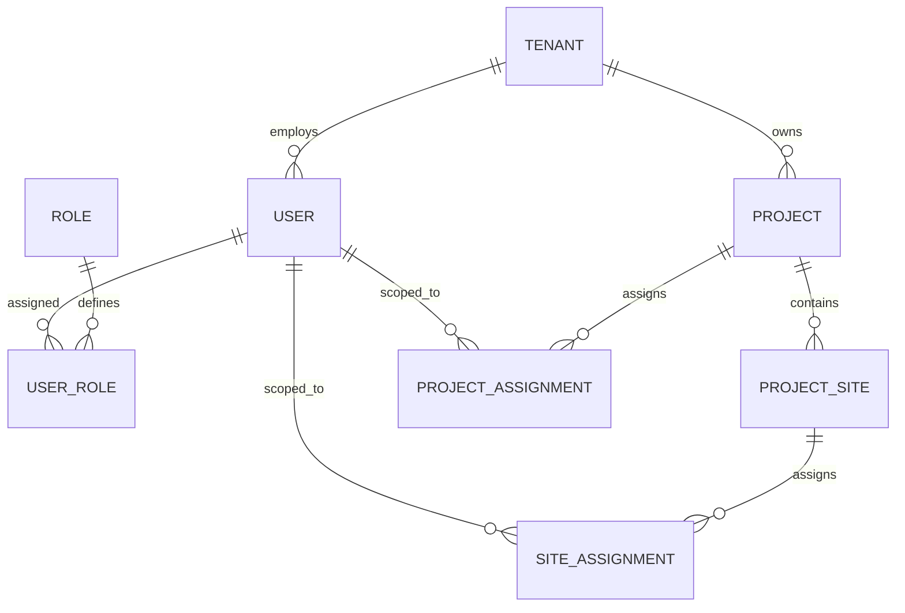

# DEZOBUILD — Authoritative Backend Authorization & RBAC Model

**Phase**: Backend Architecture Definition  
**Mode**: Contract-First Authorization Architecture  
**Status**: Authoritative Blueprint (Pre-Implementation Gate)  

---

## 1. The Four Independent Authorization Dimensions

Authorization in DEZOBUILD is determined by the intersection of four orthogonal, non-interchangeable concepts:

```text
┌──────────────────────────────────────────────────────────────────────────────────────────────────┐
│                                                                                                  │
│  AUTHORIZATION DECISION =                                                                        │
│      Authenticated Session                                                                       │
│  AND Correct Portal Audience (owner.dezobuild.com vs app.dezobuild.com)                           │
│  AND Valid Active Tenant (status == ACTIVE)                                                      │
│  AND Feature Entitlement Enabled on Subscription Plan                                            │
│  AND Atomic Permission Granted to Active Role                                                    │
│  AND Target Resource Within User's Project / Site Scope                                          │
│  AND Invariant Business Rules Satisfied                                                          │
│                                                                                                  │
└──────────────────────────────────────────────────────────────────────────────────────────────────┘
```

### Definitions

1. **ROLE**: *Who the user is within the organizational hierarchy* (e.g., `PROJECT_MANAGER`, `ACCOUNTANT`).
2. **PERMISSION**: *What discrete action the user is authorized to perform* (e.g., `materials:purchase_orders:approve`).
3. **FEATURE ENTITLEMENT**: *Whether the tenant's commercial subscription tier unlocks the capability* (e.g., `ai_cost_forecasting`, `custom_workflow_rules`).
4. **SCOPE**: *Which specific tenant, project, site, or personal resources the user is permitted to touch* (e.g., Project `"PRJ-METRO-01"` / Site `"Pier 42"`).

> [!IMPORTANT]
> A user possessing `materials:purchase_orders:approve` cannot approve a PO belonging to a Project they are not assigned to (`Scope Failure`).  
> A user assigned to a Project cannot approve a PO if their role lacks the permission (`Permission Failure`).  
> A user with both role and scope cannot use advanced OCR if the tenant is on the Starter Plan (`Entitlement Failure`).

---

## 2. Authoritative Role Matrix

### Platform Role (Portal: `owner.dezobuild.com`)
`SUPER_ADMIN` is the only platform governance role. It is completely segregated from the customer database.

### Customer Roles (Portal: `app.dezobuild.com`)

| Role Identifier | Portal | Default Tenant Scope | Default Project Scope | Default Site Scope | Primary Business Focus | View | Create | Edit | Approve | Reject | Pay / Post | Export | Admin |
| :--- | :--- | :--- | :--- | :--- | :--- | :---: | :---: | :---: | :---: | :---: | :---: | :---: | :---: |
| **`SUPER_ADMIN`** | `owner` | **Global Platform** | **None** | **None** | SaaS Governance, Billing, Platform Ops | ✅ | ✅ | ✅ | ✅ | ✅ | ✅ | ✅ | ✅ |
| **`COMPANY_OWNER`** | `app` | **Full Tenant** | **All Projects** | **All Sites** | Executive Oversight, Commercials | ✅ | ✅ | ✅ | ✅ | ✅ | ✅ | ✅ | ✅ |
| **`COMPANY_ADMIN`** | `app` | **Full Tenant** | **All Projects** | **All Sites** | System Administration, User Access | ✅ | ✅ | ✅ | ✅ | ✅ | ❌ | ✅ | ✅ |
| **`PROJECT_MANAGER`**| `app` | **Tenant Restricted**| **Assigned Projects**| **Assigned Sites** | Planning, DPR Approval, Site POs | ✅ | ✅ | ✅ | ✅ | ✅ | ❌ | ✅ | ❌ |
| **`SITE_ENGINEER`** | `app` | **Tenant Restricted**| **Assigned Projects**| **Assigned Sites** | Daily DPRs, Snags, Indents, Muster | ✅ | ✅ | ✅ | ❌ | ❌ | ❌ | ❌ | ❌ |
| **`PROCUREMENT_STORE`**| `app` | **Tenant Restricted**| **Assigned Projects**| **Assigned Sites** | POs, GRN Receipts, Issues, Stock | ✅ | ✅ | ✅ | ✅ | ✅ | ❌ | ✅ | ❌ |
| **`ACCOUNTANT`** | `app` | **Full Tenant** | **All Projects** | **All Sites** | Expenses, Invoices, Payments, Ledgers | ✅ | ✅ | ✅ | ✅ | ✅ | ✅ | ✅ | ❌ |
| **`HR`** | `app` | **Full Tenant** | **All Projects** | **All Sites** | Staff Directory, Leave, Muster Roll | ✅ | ✅ | ✅ | ✅ | ✅ | ❌ | ✅ | ❌ |
| **`EMPLOYEE`** | `app` | **Tenant Restricted**| **Assigned Projects**| **Assigned Sites** | Self-Service, Assigned Tasks, Leave | ✅ | ❌ | ❌ | ❌ | ❌ | ❌ | ❌ | ❌ |
| **`VIEWER`** | `app` | **Tenant Restricted**| **Assigned Projects**| **Assigned Sites** | Read-Only Audit & Reporting | ✅ | ❌ | ❌ | ❌ | ❌ | ❌ | ✅ | ❌ |

---

## 3. Granular Permission Namespaces

All permissions are formatted as `domain:subdomain:action` strings.

### Projects & Planning Namespace (`projects:*`)
- `projects:view` — Read project overview, KPI metrics, health status.
- `projects:create` — Create new project and define baseline contract parameters.
- `projects:edit` — Update project metadata, client information, target completion dates.
- `projects:archive` — Archive completed projects.
- `projects:wbs:view` — View WBS hierarchical structure and activity dependencies.
- `projects:wbs:manage` — Add, update, reschedule, or delete WBS activity packages.
- `projects:dpr:view` — View daily progress reports and attached site photos.
- `projects:dpr:create` — Fill and submit daily site DPR logs.
- `projects:dpr:edit` — Update draft or rejected DPR submissions.
- `projects:dpr:approve` — Formally verify and sign off daily progress reports.
- `projects:dpr:reject` — Reject DPR submission with mandatory corrective remarks.

### Procurement & Store Namespace (`materials:*`)
- `materials:view` — View material master catalog and unit rate benchmarks.
- `materials:requirements:create` — Calculate and define BOQ material budgets.
- `materials:indents:view` — Read site material indents and status.
- `materials:indents:create` — Submit site material indent requisition.
- `materials:indents:approve` — Authorize indent for PO generation.
- `materials:indents:reject` — Reject indent requisition.
- `materials:purchase_orders:view` — Read purchase orders and delivery schedules.
- `materials:purchase_orders:create` — Issue purchase order to registered vendor.
- `materials:purchase_orders:approve` — Approve PO commercial commitment.
- `materials:purchase_orders:reject` — Reject PO proposal.
- `materials:grn:view` — View Goods Receipt Notes and gate passes.
- `materials:grn:create` — Record physical gate arrival and delivery challan.
- `materials:grn:approve` — Accept inspected material into active inventory.
- `materials:inventory:view` — View warehouse stock balances and valuation.
- `materials:inventory:manage` — Adjust inventory locations and safety stock thresholds.
- `materials:issue:create` — Issue material from warehouse to site activity.
- `materials:return:create` — Return excess site material to warehouse.
- `materials:transfer:create` — Authorize inter-site stock transfer.
- `materials:vendors:view` — View registered vendor directory.
- `materials:vendors:manage` — Onboard vendor, update GSTIN, banking, and payment terms.

### Finance & Commercial Namespace (`finance:*`)
- `finance:view` — View financial dashboard, committed costs, and actual cash burn.
- `finance:manage` — Create expenses, schedule payment vouchers, create advances.
- `finance:approve` — Approve site expenses and authorize payment vouchers.
- `finance:pay` — Disburse payment, execute bank UTR posting, and reconcile payables.
- `finance:budget:manage` — Allocate and revise cost code budget baselines.
- `finance:receivables:manage` — Generate client RA bills and track retention receivables.

### People & HR Namespace (`people:*`, `attendance:*`, `leave:*`)
- `people:view` — View employee directory and subcontractor gangs.
- `people:manage` — Onboard staff, register labour agencies, configure wage rates.
- `attendance:view` — View staff biometric muster roll and labour headcounts.
- `attendance:manage` — Record daily muster roll and regularize attendance exceptions.
- `leave:view` — View leave requests and annual balances.
- `leave:apply` — Submit personal leave application.
- `leave:approve` — Approve employee leave request.

### Plant & Equipment Namespace (`equipment:*`)
- `equipment:view` — View machinery asset registry, location, and running hours.
- `equipment:manage` — Register machinery, log diesel bowser issues, open maintenance tickets.
- `equipment:service:approve` — Authorize maintenance ticket and sign off repair expenditure.

### Issues & Alerts Namespace (`issues:*`, `alerts:*`)
- `issues:view` — View site snags, safety hazards, and schedule blockers.
- `issues:create` — Log new site issue with defect photos and severity.
- `issues:resolve` — Rectify, verify, and close site issue.
- `alerts:view` — View automated smart alert exception feed.
- `alerts:acknowledge` — Acknowledge risk blocker and initiate corrective action.

### Documents & Drawings Vault Namespace (`documents:*`)
- `documents:view` — View and download GFC drawings, contracts, and NOCs.
- `documents:create` — Upload document and new drawing revisions.
- `documents:approve` — Formally approve GFC revision for site construction release.

### Analytics & Reports Namespace (`reports:*`)
- `reports:view` — View standard dashboards and report catalogs.
- `reports:export` — Generate and download official PDF / XLSX audit reports.

### Administration Namespace (`admin:*`)
- `admin:users` — Invite users, deactivate accounts, assign RBAC roles.
- `admin:roles` — View and configure tenant custom role capabilities.
- `admin:projects` — Master project site setup and geofencing.
- `admin:settings` — Update company profile, GSTIN, PAN, and corporate defaults.
- `admin:audit` — View immutable system audit trail.

### Platform Owner Governance Namespace (`platform:*`)
- `platform:tenants:view` — Inspect all provisioned tenant workspaces.
- `platform:tenants:manage` — Provision, suspend, or terminate customer tenants.
- `platform:plans:manage` — Configure SaaS plan pricing and entitlement limits.
- `platform:subscriptions:manage` — Update tenant subscription tier and billing cycle.
- `platform:support:manage` — Handle cross-tenant support sessions with audit logging.
- `platform:settings:manage` — Toggle global platform maintenance and security policies.

---

## 4. User Project and Site Assignment Scoping



### Assignment Rules by Persona:
1. **Global Tenant Personas** (`COMPANY_OWNER`, `COMPANY_ADMIN`, `ACCOUNTANT`, `HR`):
   - Access is tenant-global. `ProjectAssignment` table is not queried; their queries join strictly on `company_id`.
2. **Project-Scoped Personas** (`PROJECT_MANAGER`, `VIEWER`):
   - Query filters enforce: `WHERE company_id = :tenantId AND id IN (SELECT project_id FROM project_assignments WHERE user_id = :userId)`.
3. **Site-Scoped Personas** (`SITE_ENGINEER`, `PROCUREMENT_STORE`):
   - Query filters enforce: `WHERE company_id = :tenantId AND project_id IN (SELECT project_id FROM project_assignments WHERE user_id = :userId) AND site_id IN (SELECT site_id FROM site_assignments WHERE user_id = :userId)`.
4. **Self-Scoped Personas** (`EMPLOYEE`):
   - Query filters enforce: `WHERE company_id = :tenantId AND employee_id = :userEmployeeId`.
