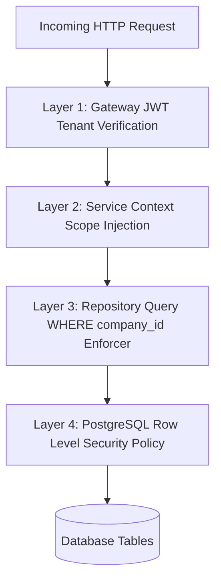

# DEZOBUILD — Authoritative Backend Security, Authentication & Threat Model

**Phase**: Backend Architecture Definition  
**Mode**: Security Architecture & Adversarial Threat Modeling  
**Status**: Authoritative Blueprint (Pre-Implementation Gate)  

---

## 1. Authentication Contract & Cryptographic Tokens

Authentication in DEZOBUILD is token-based with server-tracked session invalidation vectors.

### JWT Token Claims Structure

```json
{
  "iss": "https://auth.dezobuild.com",
  "aud": "app.dezobuild.com",
  "sub": "usr_9f8e21a0b3",
  "tid": "tnt_dezo_infra_01",
  "sid": "ses_4b81c0de9a",
  "ver": 3,
  "role": "SITE_ENGINEER",
  "aal": 2,
  "iat": 1788934800,
  "exp": 1788938400
}
```

| Claim | Key Name | Purpose | Validation Rule |
| :--- | :--- | :--- | :--- |
| **Issuer** | `iss` | Originating identity provider | Must strictly match `https://auth.dezobuild.com`. |
| **Audience** | `aud` | Target application boundary | Must match `owner.dezobuild.com` or `app.dezobuild.com`. Cross-audience requests fail immediately. |
| **Subject** | `sub` | Canonical User ID | Resolves to active `users` or `platform_users` record. |
| **Tenant ID** | `tid` | Bound organization workspace | Omitted for `SUPER_ADMIN`. Mandatory for all customer tokens. |
| **Session ID** | `sid` | Active cryptographic session | Matched against `user_sessions` table in database/cache. |
| **Session Version** | `ver` | Security epoch counter | If token `ver` < `user.security_version`, token is immediately rejected. |
| **Role** | `role` | User role at token issuance | Verified against database policy before executing mutations. |
| **Assurance** | `aal` | Authenticator Assurance Level | `1` = Password only; `2` = MFA (TOTP / Hardware key) verified. |

### Edge Failure Behaviors

| Scenario | HTTP Status | Error Code | Action Taken |
| :--- | :---: | :--- | :--- |
| **Wrong Audience** (Owner token sent to App API) | `403` | `PORTAL_AUDIENCE_MISMATCH` | Request dropped; security event logged. |
| **Expired Token** (`exp < now`) | `401` | `TOKEN_EXPIRED` | Client must use refresh token rotation. |
| **Revoked Session** (`sid` deleted / blacklisted) | `401` | `SESSION_REVOKED` | Client forced to login again. |
| **Suspended Tenant** (`tenant.status == SUSPENDED`) | `403` | `TENANT_SUSPENDED` | All user access for tenant blocked. |
| **Terminated User** (`user.status == INACTIVE`) | `401` | `USER_DEACTIVATED` | Session immediately invalidated. |
| **Stale Session Version** (Password reset occurred) | `401` | `CREDENTIALS_INVALIDATED` | Token rejected across all devices. |

---

## 2. Multi-Tier Session Revocation Engine

1. **Explicit Logout**: Deletes specific `sid` from session store.
2. **Global Logout ("Logout All Devices")**: Increments `user.security_version`, instantly invalidating all tokens issued with older versions.
3. **Role Elevation / Demotion**: Updating a user's role immediately rotates their session version, forcing client re-authentication with new claims.
4. **Tenant Suspension**: Setting `tenant.status = 'SUSPENDED'` instantly terminates all customer sessions for that tenant via Redis pub/sub broadcast.

---

## 3. Defense-in-Depth Tenant Isolation & PostgreSQL RLS

Tenant isolation is enforced across four distinct software layers:



### PostgreSQL Row Level Security (RLS) Blueprint

For high-sensitivity tables (`expenses`, `purchase_orders`, `stock_ledger_entries`, `audit_logs`):

```sql
-- 1. Enable RLS on Table
ALTER TABLE purchase_orders ENABLE ROW LEVEL SECURITY;
ALTER TABLE purchase_orders FORCE ROW LEVEL SECURITY;

-- 2. Define Tenant Isolation Policy
CREATE POLICY tenant_isolation_policy ON purchase_orders
    FOR ALL
    USING (company_id = NULLIF(current_setting('app.current_tenant_id', true), '')::text);

-- 3. Application Connection Wrapper (executed at transaction start):
-- SET LOCAL app.current_tenant_id = :authenticatedTenantId;
```

> [!IMPORTANT]
> PostgreSQL RLS acts as a **failsafe guardrail**. The application query layer is still strictly required to specify `WHERE company_id = :tenantId` in all SQL queries to maximize query plan performance and index utilization.

---

## 4. Mass Assignment & Field Protection Matrix

| Field Category | Target Fields | Protection Mechanism |
| :--- | :--- | :--- |
| **Server-Managed** | `id`, `company_id`, `created_at`, `created_by`, `updated_at`, `updated_by` | Stripped from all DTO bindings; set strictly by server context. |
| **Workflow State** | `status`, `approval_status`, `approved_by`, `approved_at`, `posted_at` | Cannot be mutated via standard `PUT` / `PATCH` payloads; requires dedicated state-transition RPC endpoints (e.g. `POST /api/v1/po/:id/approve`). |
| **Financial Ledgers** | `incurred_cost`, `committed_cost`, `on_hand_qty`, `current_stock` | Read-only computed attributes; mutated strictly via transactional ledger side-effects. |
| **Role & Access** | `role`, `permissions`, `is_admin`, `security_version` | Protected by `admin:roles` / `admin:users` permission checks. |
| **User-Editable** | `description`, `phone`, `vendor_name`, `target_completion`, `notes` | Permitted in validated update DTOs. |

---

## 5. Adversarial Security Threat Model

| # | Threat Scenario | Attack Vector | Primary Backend Control | Defense-in-Depth Layer | Failure Response |
| :--- | :--- | :--- | :--- | :--- | :--- |
| **T01** | **Cross-Tenant IDOR** | Attacker changes URL parameter `po_id` to target another company's PO | Query joins on authenticated `session.company_id` | Database RLS policy | `404 Not Found` *(No existence leak)* |
| **T02** | **Project Scope Bypass** | Site Engineer on Project A attempts to read DPRs from Project B | `ProjectAssignment` table join check in query | Repository query filter | `404 Not Found` |
| **T03** | **Site Scope Bypass** | Site Engineer on Site 1 attempts to release store stock on Site 2 | `SiteAssignment` table validation in service layer | Transaction guard check | `403 Forbidden` |
| **T04** | **Role Escalation** | Client submits `{ "role": "COMPANY_OWNER" }` in user edit body | Input DTO whitelist rejects `role` field on standard updates | Dedicated admin-only endpoint | `422 Unprocessable Entity` |
| **T05** | **Permission Forgery** | Attacker alters permission claims in client-side JWT | HMAC SHA-256 / RS256 signature verification at gateway | Server-side role resolution | `401 Unauthorized` |
| **T06** | **Feature Entitlement Bypass** | Starter plan tenant calls Enterprise AI forecasting API | Gateway checks active subscription tier against required feature slug | Service entitlement check | `403 Forbidden` / `402 Payment Required` |
| **T07** | **SUPER_ADMIN Leakage** | Platform admin token presented to customer `/api/v1/expenses` | Audience check rejects `owner.dezobuild.com` tokens | Customer gateway boundary | `403 Forbidden` |
| **T08** | **Customer → Platform Access** | Tenant user attempts to access `/platform/tenants` | Platform gateway strictly requires `PlatformUser` identity | Reverse proxy isolation | `401 Unauthorized` |
| **T09** | **Platform → Customer Mutation**| Support operator mutates tenant PO without audit record | Platform operators have NO write access to tenant operational APIs | Audit log required for read | `403 Forbidden` |
| **T10** | **Mass Assignment** | Client injects `{ "status": "APPROVED" }` during PO update | Update DTOs explicitly exclude workflow state fields | State machine transition guards | Ignored / `422 Unprocessable` |
| **T11** | **Unauthorized Approval** | Site Engineer calls PO approval endpoint | Service layer verifies `materials:purchase_orders:approve` | Role policy evaluation | `403 Forbidden` |
| **T12** | **Duplicate Approval Race** | Two managers click Approve concurrently on same voucher | DB row lock (`SELECT ... FOR UPDATE`) + State check `status == SUBMITTED` | Unique transition check | Second request gets `409 Conflict` |
| **T13** | **Double Payment Posting** | Network timeout causes client to retry payment submission | Mandatory `Idempotency-Key` header verified before processing | DB unique constraint on key | Returns existing receipt |
| **T14** | **Double GRN Verification** | Two storekeepers scan same Delivery Challan twice | Unique composite constraint `(company_id, po_id, challan_no)` | Transaction lock on PO line items| `409 Conflict` |
| **T15** | **Negative Inventory Race** | Two site engineers issue same 10 bags of cement simultaneously | DB row lock on `inventory_balances` + `CHECK (on_hand_qty >= 0)` | Stock ledger debit transaction | `422 Insufficient Stock` |
| **T16** | **Payment Replay Attack** | Intercepted payment request payload replayed | Nonce / timestamp + Idempotency key expiration (24h) | Replay cache in Redis | `400 Bad Request` |
| **T17** | **Stale Token Post-Termination**| Fired employee attempts to use unexpired 1-hour JWT | Session check verifies `user.status == ACTIVE` & `sid` valid | Redis session blacklist | `401 Unauthorized` |
| **T18** | **Disabled Tenant Tampering** | Delinquent tenant attempts API mutations via open connections | Gateway middleware checks `tenant.status == ACTIVE` | Cached tenant status in memory | `403 Forbidden` |
| **T19** | **Forged Project Assignment** | User manipulates assignment IDs in headers | Project assignments loaded strictly from database by `user.id` | Server session context | Forged headers ignored |
| **T20** | **Direct S3 File URL Tampering**| Attacker guesses S3 bucket URL to read competitor drawing | Cloud storage bucket is private; files served strictly via short-lived signed URLs | Scoped authorization check | `403 Forbidden` from S3 |

---

## 6. Standard API Error Model

All API responses strictly adhere to RFC 7807 Problem Details:

```json
{
  "error": {
    "code": "INSUFFICIENT_STOCK",
    "message": "Cannot issue 50 bags of Cement (OPC 53). Current on-hand stock is 20 bags.",
    "status": 422,
    "timestamp": "2026-09-09T11:15:00.000Z",
    "request_id": "req_c8a91b2e3f4a",
    "details": [
      {
        "field": "issue_quantity",
        "requested": 50,
        "available": 20
      }
    ]
  }
}
```

### Standard Status Codes:
- `400 BAD_REQUEST`: Malformed syntax, invalid JSON, or missing required HTTP headers.
- `401 UNAUTHENTICATED`: Missing, expired, forged, or revoked authentication credentials.
- `403 FORBIDDEN`: Valid credentials, but missing role permission, boundary mismatch, or suspended tenant.
- `404 NOT_FOUND`: Resource does not exist OR belongs to another tenant/unassigned project (IDOR prevention).
- `409 CONFLICT`: Duplicate idempotency key, unique constraint collision, or concurrent state transition conflict.
- `422 UNPROCESSABLE_ENTITY`: Syntactically valid payload that violates business rules (over-budget, negative stock).
- `429 TOO_MANY_REQUESTS`: Rate limit threshold exceeded.
- `500 INTERNAL_SERVER_ERROR`: Unhandled server exception (opaque to client; detailed trace in structured logs).
