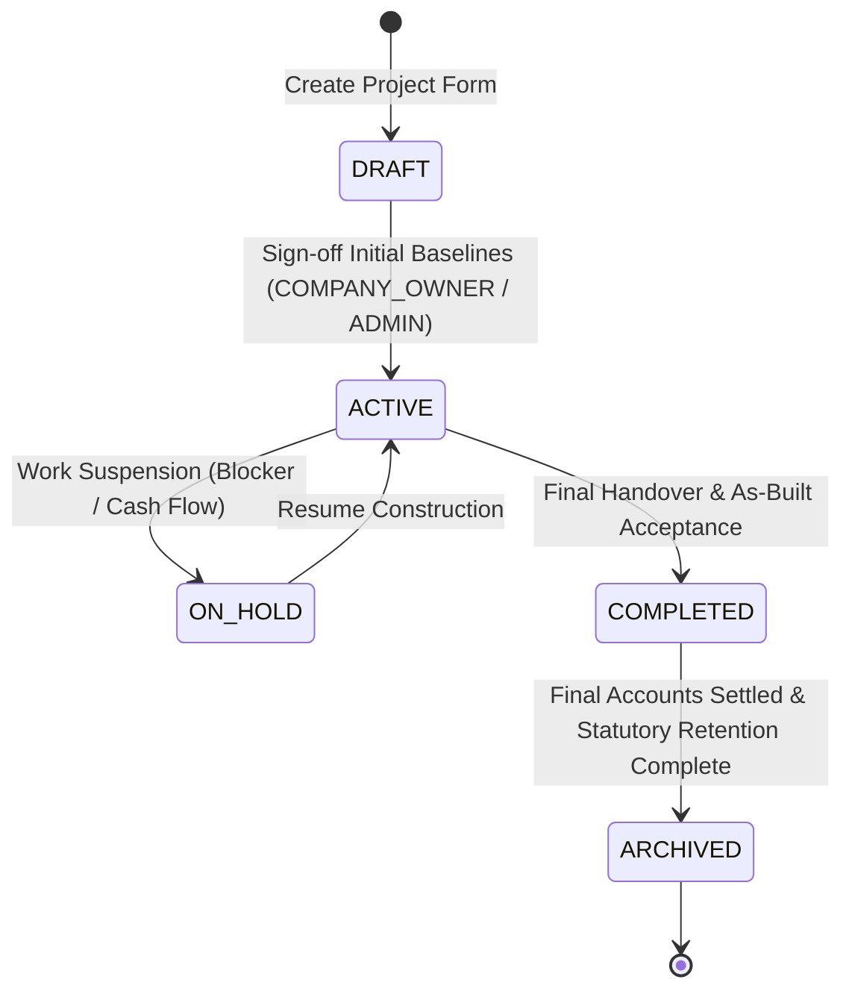
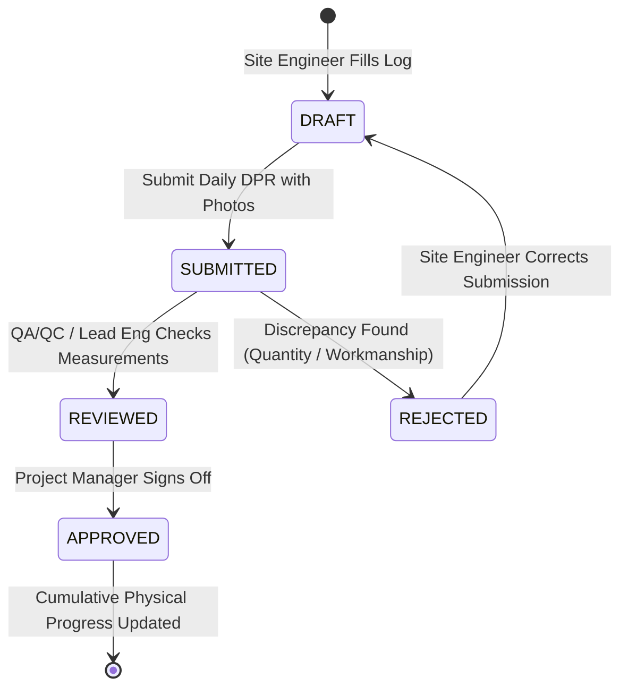
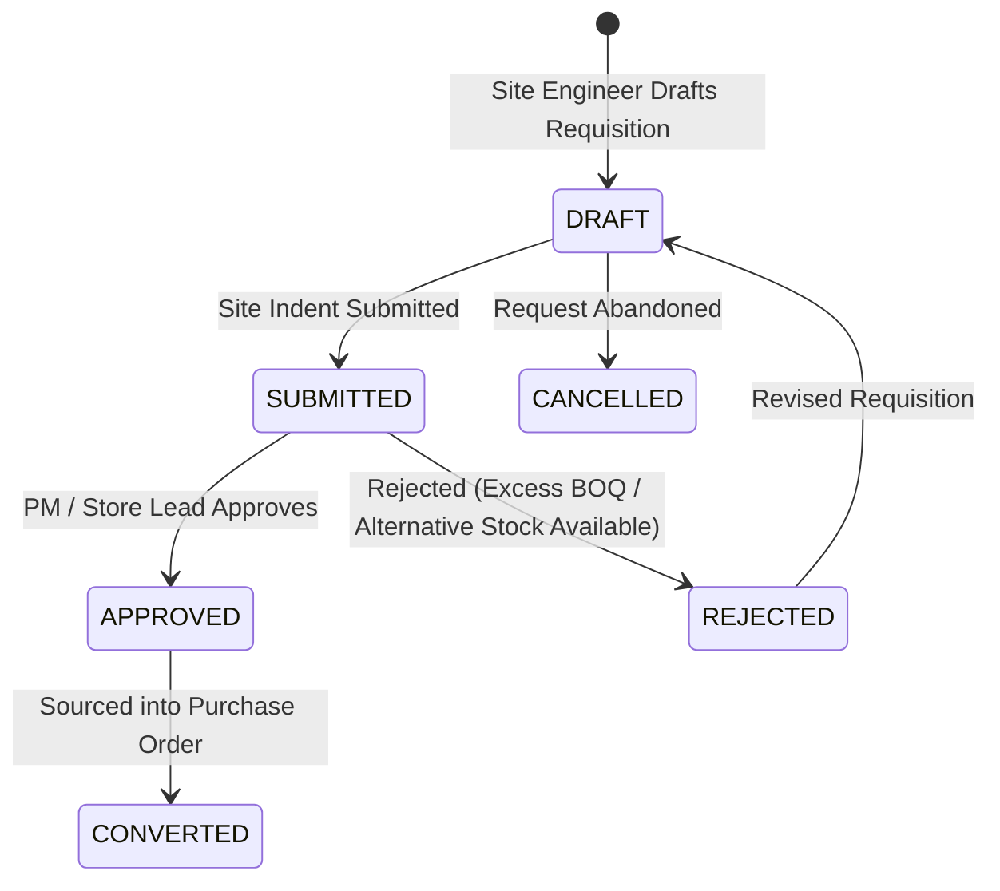
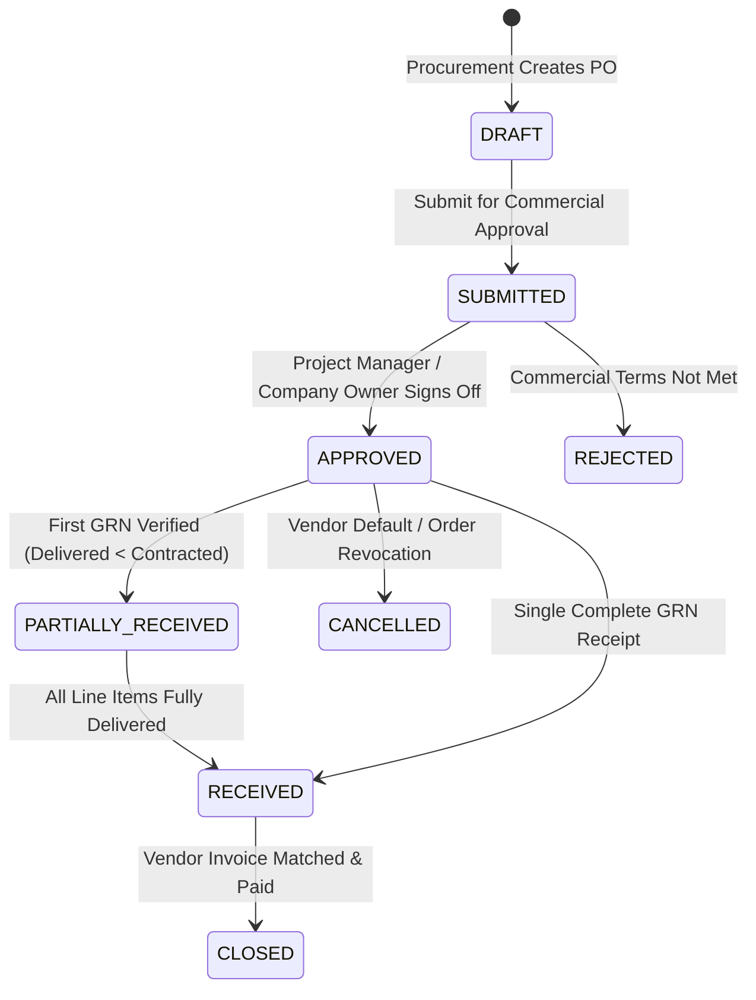
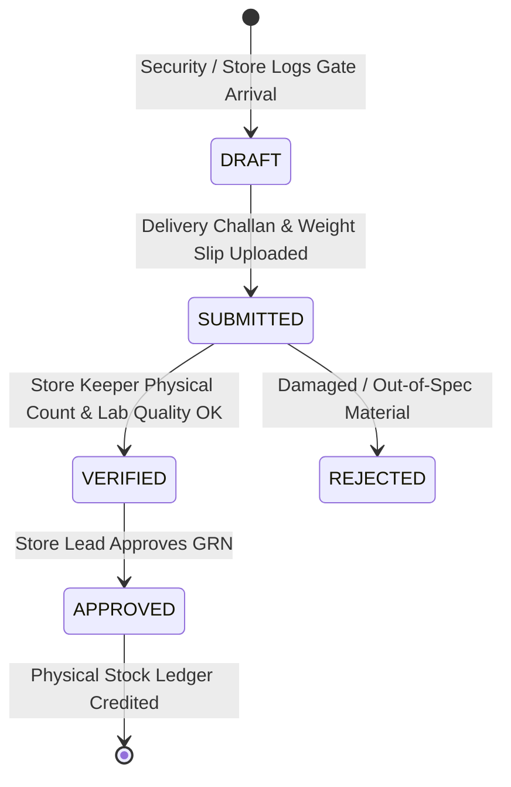
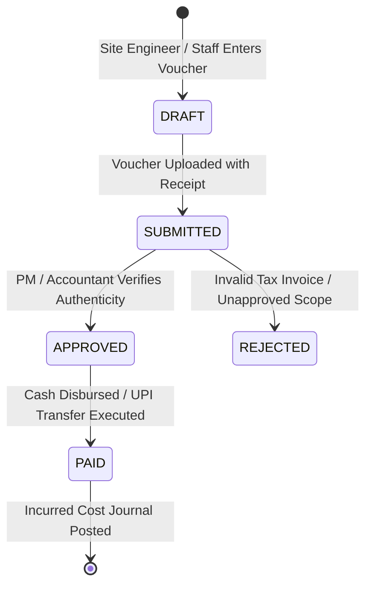
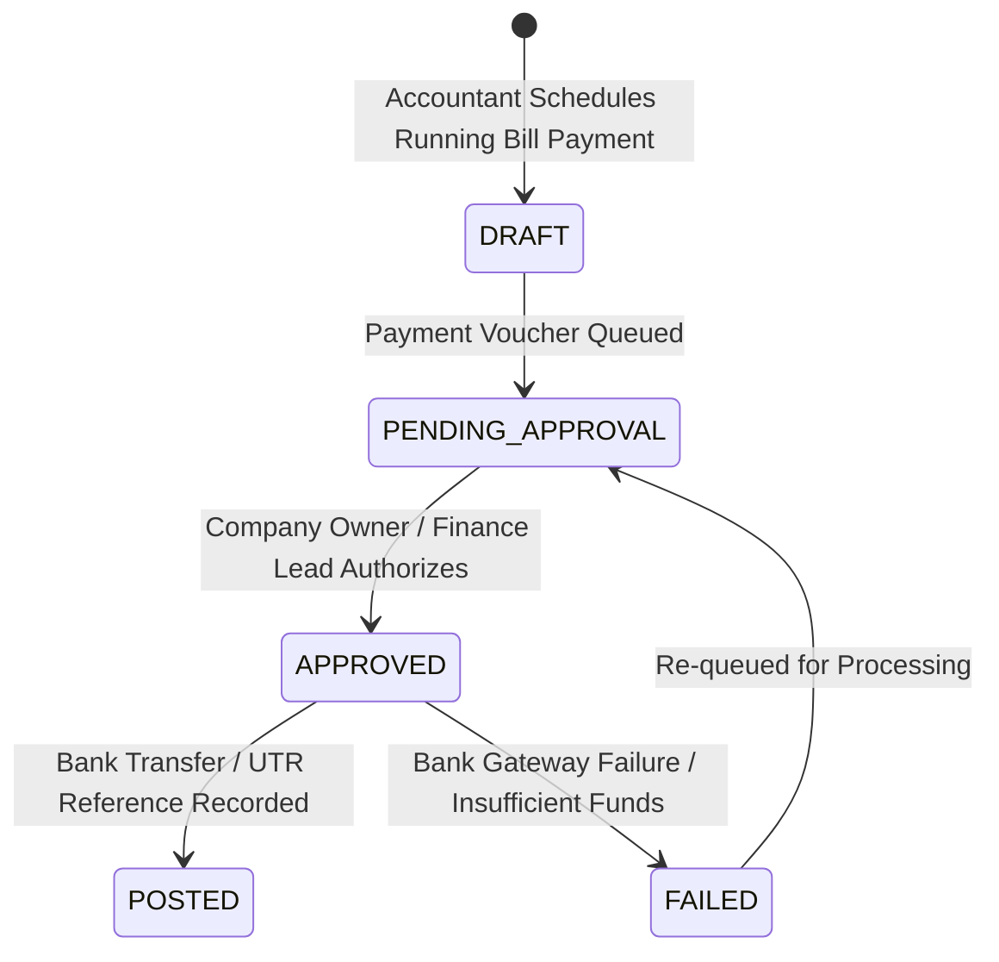
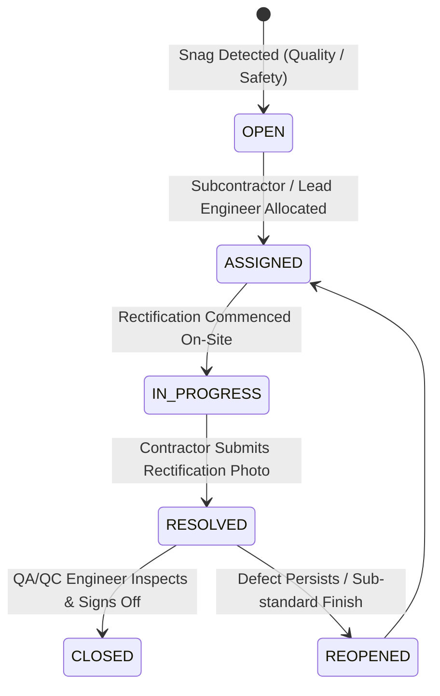
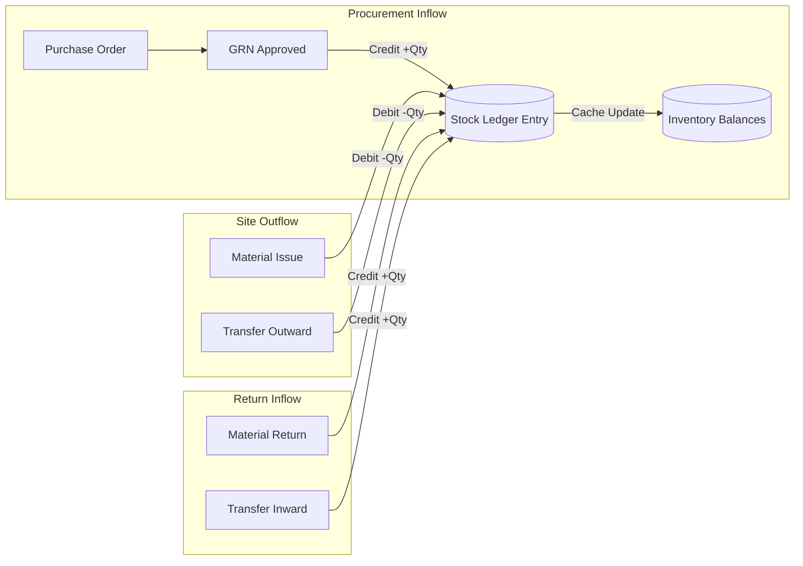

# DEZOBUILD — Authoritative Backend Workflows, State Machines & Inventory/Financial Integrity

**Phase**: Backend Architecture Definition  
**Mode**: Domain Workflow & Transaction Specification  
**Status**: Authoritative Blueprint (Pre-Implementation Gate)  

---

## 1. Authoritative Workflow State Machines

Every state machine in DEZOBUILD is strictly deterministic. Transitions require an **authorized actor role**, an **explicit permission**, **prerequisite state validation**, and trigger **immutable audit side effects**.

---

### 1. Project Lifecycle State Machine


---

### 2. Daily Progress Report (DPR) Workflow

- **Side Effect on `APPROVED`**: Advances cumulative progress on linked WBS activities, updates daily labour muster summary, and locks DPR photo attachments against editing.

---

### 3. Material Indent Workflow


---

### 4. Purchase Order (PO) Lifecycle Workflow

- **Side Effect on `APPROVED`**: Creates commercial commitment entry in Financial Ledger (`committed_cost`), reserves budget line allocation.

---

### 5. Goods Receipt Note (GRN) & Physical Stock Verification Workflow

- **Side Effect on `APPROVED`**: Executes atomic transaction:
  1. Writes debit to `stock_ledger_entries` for accepted quantities.
  2. Updates `inventory_balances` cached on-hand stock.
  3. Updates `purchase_orders.delivered_qty` (advances state to `PARTIALLY_RECEIVED` or `RECEIVED`).
  4. Generates a pending `payable` draft record for finance invoice matching.

---

### 6. Expense Voucher Workflow


---

### 7. Vendor Payment Disbursement Workflow


---

### 8. Site Issue & Snag Rectification Workflow


---

## 2. Hybrid Approval Architecture

DEZOBUILD implements a **Hybrid Tiered Approval Engine**:
- **Fixed System Rules (Baseline)**: High-risk mutations (GRN acceptance, DPR sign-off, user invitations) have fixed role-based approval gates.
- **Configurable Financial Thresholds**: Purchase orders, expenses, and payment vouchers enforce monetary thresholds:

```text
┌──────────────────────────────────────────────┬──────────────────────────────────────────────┐
│ TRANSACTION VALUE                            │ REQUIRED APPROVER ROLE                       │
├──────────────────────────────────────────────┼──────────────────────────────────────────────┤
│ PO / Expense ≤ ₹50,000                       │ PROJECT_MANAGER                              │
│ PO / Expense > ₹50,000 AND ≤ ₹5,00,000       │ PROJECT_MANAGER + ACCOUNTANT                 │
│ PO / Expense > ₹5,00,000 (Major Commercial)  │ COMPANY_OWNER                                │
│ Subcontractor Advance (Any Value)            │ PROJECT_MANAGER + COMPANY_OWNER              │
└──────────────────────────────────────────────┴──────────────────────────────────────────────┘
```

---

## 3. Authoritative Double-Entry Inventory Accounting

To guarantee mathematical consistency, inventory is never mutated with simple `stock = stock + x` statements. Every inventory event creates an **immutable stock ledger entry** with double-entry movements.



### Critical Inventory Guarantees:
1. **No Negative Stock**: An atomic database check (`CHECK (on_hand_qty >= 0)`) prevents material issues exceeding available unallocated store inventory.
2. **Double GRN Approval Prevention**: GRN approvals require an explicit transactional pessimistic lock (`SELECT * FROM goods_receipt_notes WHERE id = :id FOR UPDATE`). Once approved, status changes to `APPROVED` and cannot be re-executed.
3. **Idempotent Stock Transfers**: Stock transfer between Site A and Site B creates a single atomic transaction:
   - Debit outward from Site A `inventory_balances`
   - Create `in_transit` tracking record
   - Credit inward to Site B `inventory_balances` upon gate arrival signoff.

---

## 4. Financial Integrity & Transaction Boundaries

### Separation of Concerns:
1. **Document State**: Draft voucher with receipt photos (`DRAFT`).
2. **Approval State**: Management authorization (`APPROVED`).
3. **Posting State**: Bank settlement & general ledger posting (`POSTED`).

### Financial Transaction Boundaries:
- **Budget Commitment**: When a PO is approved, `committed_cost` on the project increases, preventing over-commitment against the approved baseline.
- **Cost Incurrence**: When a GRN is approved or an expense is marked `PAID`, `actual_cost` increases while `committed_cost` decreases by the matched amount.
- **Idempotency**: All payment disbursements require an `Idempotency-Key` header. If a network drop causes a client retry, the server returns the existing transaction receipt without executing duplicate debits.
- **No Mutation of Historical Financials**: Once an expense or payment voucher reaches `POSTED` status, it becomes permanently immutable. Adjustments require an explicit contra/reversal voucher linked to the original record.
