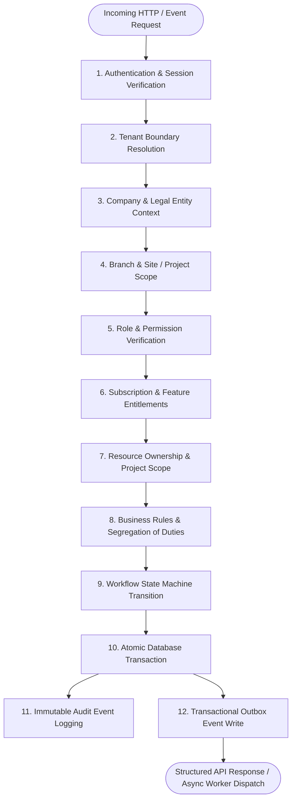

# DEZOBUILD — Backend Architecture Baseline (v1)

```text
================================================================================
Document ID     : ARCH-DEZ-001
Milestone       : BACKEND ARCHITECTURE BASELINE v1
Status          : AUTHORITATIVE BASELINE — FROZEN FOR IMPLEMENTATION
Scope           : Construction OS Backend Service Layer & REST / Event Contract
Owner           : DEZOBUILD Architecture & Platform Engineering Team
================================================================================
```

---

## 1. Executive Summary & Context

The **DEZOBUILD** frontend product scope is frozen, having completed forensic verification and unified multi-module workflows across both the Customer Tenant Operations Portal (`app.dezobuild.com`) and the Platform Owner Governance Hub (`owner.dezobuild.com`).

This document defines the authoritative, production-grade **Backend Architecture Baseline (v1)**. It establishes the domain boundaries, tenancy hierarchy, relational database model, REST API contracts, authentication and authorization pipelines, workflow state machines, transactional event bus, file storage architecture, and integration boundaries required to power the frozen frontend without requiring UI redesigns or compromising enterprise security.

---

## 2. Core Architectural Principles & Invariants



### 2.1 Non-Negotiable Rules of the System

1. **Backend is the Sole Authority**: Frontend visibility, tab hiding, or button disabling is strictly a UX convenience, **never** a security boundary. Every mutation and sensitive query is independently validated server-side.
2. **Strict Multi-Tenant Isolation**: Every database table in tenant space contains an indexed `tenant_id`. Every SQL query, join, and update is forced through a tenant filter. Cross-tenant data leakage is architecturally impossible.
3. **Platform vs Tenant Separation**: Platform Owner (`SUPER_ADMIN`) operates exclusively within the Platform Governance context (`owner.dezobuild.com`). `SUPER_ADMIN` is **not** a tenant role and has no implicit bypass inside tenant operational workflows.
4. **9 Authoritative Customer Roles**: Only the 9 frozen customer roles exist: `COMPANY_OWNER`, `COMPANY_ADMIN`, `PROJECT_MANAGER`, `SITE_ENGINEER`, `PROCUREMENT_STORE`, `ACCOUNTANT`, `HR`, `EMPLOYEE`, `VIEWER`.
5. **Separation of Commercial & Material Lifecycles**:
   * $\text{Material Indent} \neq \text{Purchase Order}$
   * $\text{Purchase Order} \neq \text{GRN}$
   * $\text{GRN} \neq \text{Vendor Invoice}$
   * $\text{Vendor Invoice} \neq \text{Payable}$
   * $\text{Payable} \neq \text{Payment Disbursement}$
   * $\text{Approved} \neq \text{Paid}$
6. **Physical Inventory $\neq$ Financial Accounting**: Material stock balances and movements operate on an immutable physical stock ledger ($+ / -$ quantities at physical store locations). Financial general ledger postings are a distinct, downstream accounting concern.
7. **Reliable Asynchrony via Transactional Outbox**: Domain events intended for webhooks, asynchronous background tasks, alerts, or external synchronization are committed to a durable `outbox_events` table within the same ACID transaction as the state mutation.
8. **Object Storage Decoupling**: Database stores strictly metadata, checksums, and tenant-scoped keys. Binary files are uploaded and served exclusively via short-lived, pre-signed URLs.

---

## 3. High-Level System Topology

```text
                                +-------------------------------------------+
                                |               Clients / Edge              |
                                +-------------------------------------------+
                                  |                                       |
                   (Customer Operations App)                  (Owner Governance Portal)
                     app.dezobuild.com                           owner.dezobuild.com
                                  |                                       |
                                  +-------------------+-------------------+
                                                      |
                                                      v
                                      +-------------------------------+
                                      |   Edge Gateway / Reverse Proxy|
                                      |    (Rate Limiting, TLS, CORS) |
                                      +-------------------------------+
                                                      |
                                                      v
                                      +-------------------------------+
                                      |   DEZOBUILD Backend API Core  |
                                      |   (Node.js / TypeScript / REST|
                                      +-------------------------------+
                                        |             |             |
                 +----------------------+             |             +-----------------------+
                 |                                    |                                     |
                 v                                    v                                     v
+-------------------------------+   +---------------------------------+   +---------------------------------+
|      Security & Context       |   |      Domain Service Modules     |   |       Data & Event Layer        |
|-------------------------------|   |---------------------------------|   |---------------------------------|
| • JWT & Session Validator     |   | • Identity & Access Control     |   | • PostgreSQL (Prisma ORM)       |
| • Tenant Context Resolver     |   | • Tenancy & Enterprise Master   |   |   - Operational OLTP Tables     |
| • RBAC Permission Interceptor |   | • Projects, WBS & Progress      |   |   - Immutable Stock Ledgers     |
| • Project Scope Guard         |   | • Materials & 3-Way Match GRN   |   |   - Audit & Outbox Tables       |
| • Entitlement Limit Evaluator |   | • Finance, RA Bills & Payouts   |   | • S3-Compatible Object Storage  |
| • Idempotency Key Processor   |   | • People, Biometrics & Muster   |   | • Async Outbox Worker Process   |
| • Request Correlation Tracer  |   | • Equipment & Fuel Telematics   |   | • Redis (Optional Token Black-  |
+-------------------------------+   | • Quality, NCR & Safety EHS     |   |   list & Cache - V2)            |
                                    | • Documents, RFIs & Drawings    |   +---------------------------------+
                                    | • Configurable Approval Engine  |
                                    | • Smart Anomaly Alerts Engine   |
                                    +---------------------------------+
```

---

## 4. Layered Architecture & Request Pipeline

Every incoming HTTP request traverses a deterministic 10-stage execution pipeline:

```text
1. Request & Trace Injection
   └── Assign X-Correlation-ID and X-Request-ID. Initialize structured request logger.

2. Authentication
   └── Validate HttpOnly session cookie or Bearer JWT. Verify token signature, expiration, and session version.

3. Tenant & Entity Resolution
   └── Extract tenant_id from security context. Assert user is an active member of this tenant.
   └── Resolve Company / Legal Entity and Branch bindings.

4. Session & Account Liveness
   └── Assert user status = ACTIVE and tenant status = ACTIVE / IN_GOOD_STANDING.

5. Subscription & Entitlement Check
   └── Verify tenant's subscription tier (Starter / Professional / Enterprise) entitles the requested feature.
   └── Verify capacity thresholds (e.g., maximum active projects limit).

6. RBAC & Permission Namespace Verification
   └── Match user's assigned role against required permission (e.g., finance:expense:approve).

7. Project / Site Scope Authorization
   └── For project-scoped mutations, verify user has explicit membership or tenant-wide administrative scope.

8. Input Validation & DTO Sanitization
   └── Zod validation of request body, query parameters, and path variables. Reject with 422 on schema violation.

9. Domain Service Execution (ACID Transaction)
   ├── Acquire necessary row-level locks (e.g., SELECT FOR UPDATE on StockBalance / ProjectBudget).
   ├── Execute business invariants and state machine checks.
   ├── Mutate operational entity state.
   ├── Append immutable ledger entries (e.g., StockLedger, AuditEvent).
   └── Insert durable OutboxEvent for asynchronous delivery.

10. Standardized Response & Outbox Dispatch
   └── Format response using ApiResponse<T> (or RFC 7807 problem details on error). Return HTTP 200/201/204.
```

---

## 5. Domain Verticals Overview

The DEZOBUILD backend organizes all construction operations into **17 cohesive domain modules**:

| # | Domain Module | Responsibility | Key Entities |
| :--- | :--- | :--- | :--- |
| **01** | **Identity & Access** | Authentication, sessions, users, credentials, role assignments | `User`, `Session`, `Role`, `Permission`, `UserRoleAssignment` |
| **02** | **Tenancy & Master** | Multi-tenant boundaries, legal companies, branches, sites | `Tenant`, `Company`, `Branch`, `Site`, `Department` |
| **03** | **Subscriptions** | SaaS billing plans, capacity limits, feature entitlement enforcement | `Plan`, `PlanFeature`, `TenantSubscription`, `EntitlementSnapshot` |
| **04** | **Projects & WBS** | Project registry, Work Breakdown Structure, milestones | `Project`, `ProjectMember`, `WbsActivity`, `Milestone`, `LookaheadItem` |
| **05** | **Progress & DPR** | Daily progress reporting, labour/machinery shift logs, site photos | `DprRecord`, `DprManpower`, `DprEquipment`, `DprMaterial`, `DprPhoto` |
| **06** | **Commercial & Budget**| Contracts, cost ledgers, Estimate at Completion (EAC), variance | `ProjectBudget`, `CostItem`, `CommercialContract`, `BudgetVariance` |
| **07** | **BOQ & Measurement** | Bill of Quantities items, Digital Measurement Book (MB), verification | `BoqItem`, `DigitalMbRecord`, `MeasurementDimension`, `MbVerification` |
| **08** | **Procurement** | Material catalogue, site indents, RFQs, PO lifecycle, 3-way GRN | `MaterialItem`, `MaterialIndent`, `PurchaseOrder`, `GrnRecord`, `GrnItem` |
| **09** | **Inventory & Stores**| Store locations, bin balances, physical stock ledger, transfers, issues | `Store`, `StockBalance`, `StockLedger`, `MaterialIssue`, `StockTransfer` |
| **10** | **Finance & Billing** | Petty cash, vouchers, contractor RA bills, client claims, advances | `Expense`, `PaymentVoucher`, `Advance`, `ContractorRaBill`, `ClientClaim` |
| **11** | **People & Muster** | Employees, labour contractors, biometric attendance, overtime | `Employee`, `LabourContractor`, `AttendanceRecord`, `AttendanceEntry` |
| **12** | **Fleet & Equipment** | Heavy asset registry, telematics, hour meters, fuel logs, maintenance | `EquipmentAsset`, `FuelLog`, `MaintenanceTicket`, `EquipmentOperator` |
| **13** | **Quality (QA/QC)** | Concrete pour cards, pre-pour checklists, defects, NCR workflows | `PourCard`, `PourChecklist`, `NcrRecord`, `CapaAction` |
| **14** | **Safety (EHS)** | Walkthrough checklists, safety violations, near-misses, incidents | `SafetyWalkthrough`, `SafetyIncident`, `SafetyViolation` |
| **15** | **Documents & RFIs** | GFC drawings, revisions, transmittals, technical RFIs & responses | `Document`, `DrawingRecord`, `DrawingRevision`, `RfiRecord` |
| **16** | **Approvals Engine** | Policy-driven multi-stage approval routing, segregation of duties | `ApprovalRule`, `ApprovalStage`, `ApprovalRequest`, `ApprovalDecision` |
| **17** | **Alerts & Outbox** | Anomaly detection engine, audit ledger, transactional outbox | `SmartAlert`, `AlertRule`, `AuditEvent`, `OutboxEvent`, `ReportExecution` |

---

## 6. Document Suite Organization

This baseline document is supported by 11 detailed, authoritative domain and architectural specifications in `docs/architecture/backend/`:

1. [`backend-domain-model.md`](file:///c:/Users/priya/Downloads/Dezobuild/docs/architecture/backend/backend-domain-model.md) — Exhaustive domain models, boundaries, aggregate roots, and invariants.
2. [`backend-database-design.md`](file:///c:/Users/priya/Downloads/Dezobuild/docs/architecture/backend/backend-database-design.md) — Complete relational schema (PostgreSQL + Prisma), indexing, and constraints.
3. [`backend-api-contract.md`](file:///c:/Users/priya/Downloads/Dezobuild/docs/architecture/backend/backend-api-contract.md) — REST API endpoints, DTO schemas, error contracts, and idempotency rules.
4. [`backend-auth-security.md`](file:///c:/Users/priya/Downloads/Dezobuild/docs/architecture/backend/backend-auth-security.md) — Authentication, sessions, RBAC catalog, and scoping engine.
5. [`backend-workflow-state-machines.md`](file:///c:/Users/priya/Downloads/Dezobuild/docs/architecture/backend/backend-workflow-state-machines.md) — Formal lifecycle state machines for all 17 operational entities.
6. [`backend-event-architecture.md`](file:///c:/Users/priya/Downloads/Dezobuild/docs/architecture/backend/backend-event-architecture.md) — Audit trails, domain events, and transactional outbox dispatcher.
7. [`backend-file-storage.md`](file:///c:/Users/priya/Downloads/Dezobuild/docs/architecture/backend/backend-file-storage.md) — S3-compatible pre-signed upload/download and metadata architecture.
8. [`backend-integration-architecture.md`](file:///c:/Users/priya/Downloads/Dezobuild/docs/architecture/backend/backend-integration-architecture.md) — Biometrics, ERP (Tally/SAP), Payment Gateways, Notifications, AI, and Excel Import.
9. [`backend-threat-model.md`](file:///c:/Users/priya/Downloads/Dezobuild/docs/architecture/backend/backend-threat-model.md) — STRIDE security analysis, IDOR mitigations, and attack defenses.
10. [`backend-frontend-integration-map.md`](file:///c:/Users/priya/Downloads/Dezobuild/docs/architecture/backend/backend-frontend-integration-map.md) — 1:1 route and component integration map to frozen frontend.
11. [`backend-decisions-and-open-questions.md`](file:///c:/Users/priya/Downloads/Dezobuild/docs/architecture/backend/backend-decisions-and-open-questions.md) — Architectural Decision Records (ADRs) and classified open questions.
