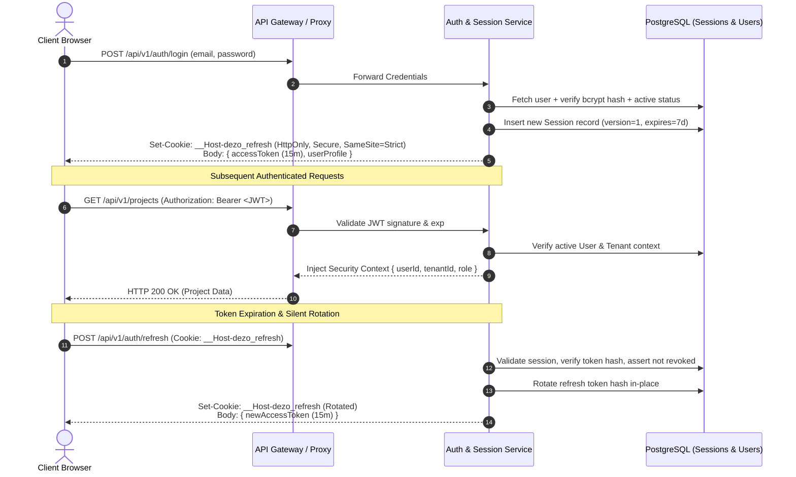
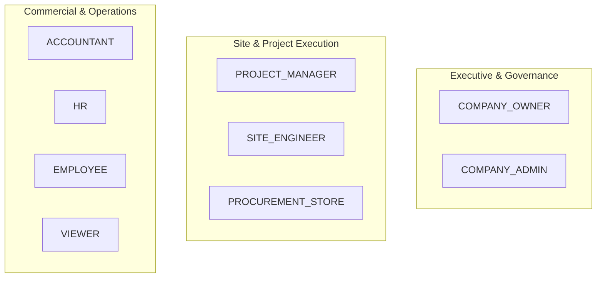
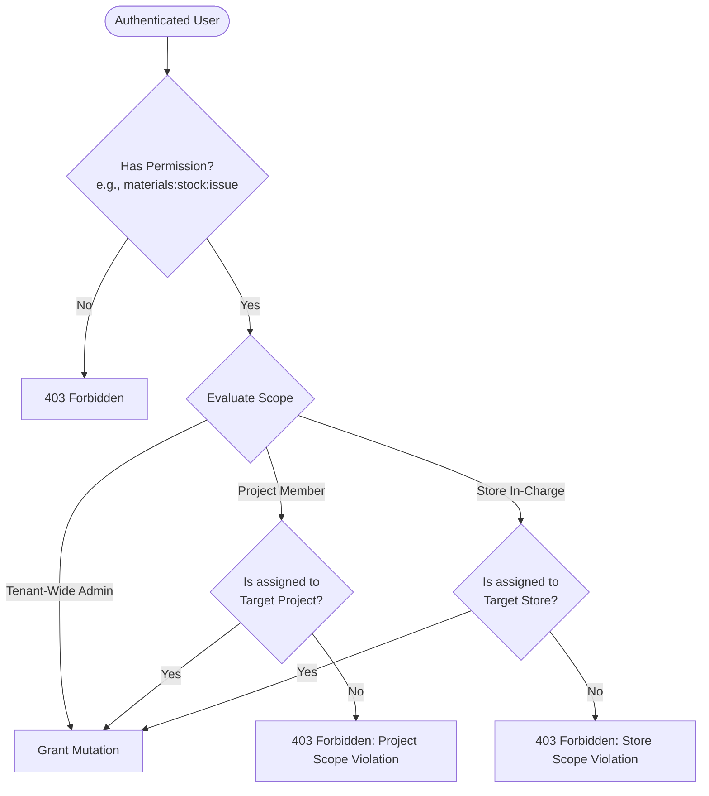

# DEZOBUILD — Authentication, RBAC & Security Architecture (v1)

```text
================================================================================
Document ID     : ARCH-DEZ-005
Milestone       : BACKEND ARCHITECTURE BASELINE v1
Status          : AUTHORITATIVE BASELINE — FROZEN FOR IMPLEMENTATION
Scope           : Identity, Session Management, Authoritative RBAC & Scoping Engine
================================================================================
```

---

## 1. Authentication Architecture

DEZOBUILD employs a **defense-in-depth, token-session hybrid authentication model** designed for secure single-page applications and multi-tenant isolation.



### 1.1 Token Specifications & Lifecycles

| Token Type | Lifespan | Storage & Transport | Claims / Payload |
| :--- | :--- | :--- | :--- |
| **Access Token** | 15 Minutes | In-memory client storage (`Authorization: Bearer`) | `iss`, `aud`, `sub` (userId), `tid` (tenantId), `sid` (sessionId), `ver` (sessionVersion), `exp`, `iat` |
| **Refresh Token** | 7 Days (Sliding) | `HttpOnly`, `Secure`, `SameSite=Strict`, `__Host-` prefixed cookie | High-entropy crypto random bytes (SHA-256 hashed in database) |
| **Password Reset**| 1 Hour | Single-use cryptographically signed token | `sub`, `purpose: pwd_reset`, `nonce` |

### 1.2 Non-Authoritative JWT Rule
> [!IMPORTANT]
> **JWT Claims are NEVER authoritative for permissions**.
> While the JWT contains `sub` (User ID) and `tid` (Tenant ID), the server **always validates the real-time session version, active role assignments, subscription entitlements, and project scopes** from cached security contexts or database lookups on every protected mutation.

---

## 2. Comprehensive 9 Authoritative Customer Roles

Only the following **9 customer roles** exist within the tenant workspace. `SUPER_ADMIN` belongs exclusively to the Platform Owner portal (`owner.dezobuild.com`).



### 2.1 Role Authority & Responsibility Matrix

| Role Code | Display Name | Scope Authority | Primary Responsibilities & Boundaries |
| :--- | :--- | :--- | :--- |
| `COMPANY_OWNER` | Company Owner | Enterprise / All Projects | Full corporate authority, subscription management, final commercial/payout approvals, budget baseline revisions. |
| `COMPANY_ADMIN` | Company Admin | Enterprise / All Projects | User management, RBAC configuration, company/branch masters, global approval policies, vendor onboardings. |
| `PROJECT_MANAGER` | Project Manager | Assigned Projects | Project WBS, milestone scheduling, DPR approval, contractor RA bill verification, site budget control. |
| `SITE_ENGINEER` | Site Engineer | Assigned Sites / Projects | Daily DPR submission, physical measurement book (MB) recording, concrete pour card checklists, safety logs. |
| `PROCUREMENT_STORE`| Procurement & Store | Stores / Assigned Sites | Material indents, PO generation, 3-way match GRN verification, store issues, inter-site stock transfers. |
| `ACCOUNTANT` | Accountant | Tenant / Company | Financial invoices, expense approvals, tax deduction compliance (TDS, Cess), contractor payment vouchers. |
| `HR` | HR & Workforce | Tenant / Branch | Employee roster, trade subcontractor muster, biometric turnstile reconciliations, overtime wage impact. |
| `EMPLOYEE` | Employee / Staff | Assigned Tasks | Task execution, personal daily attendance, personal expense claims, drawing viewing. |
| `VIEWER` | Auditor / Viewer | Read-Only | Read-only executive visibility across dashboards, progress summaries, and compliance documents. |

---

## 3. Granular Permission Namespaces

Permissions follow a hierarchical `domain:entity:action` taxonomy:

```text
projects:
  ├── projects:view                  # View project registry & summaries
  ├── projects:create                # Create new capital project
  ├── projects:manage                # Update metadata, archive project
  ├── projects:wbs:edit              # Modify WBS tree & activities
  ├── projects:dpr:create            # Create daily progress reports (DPR)
  ├── projects:dpr:submit            # Submit DPR for approval
  └── projects:dpr:approve           # Approve DPR & update executed quantities

materials:
  ├── materials:view                 # View material masters, stock balances
  ├── materials:manage               # Create/edit catalogue items & rates
  ├── materials:indent:create        # Create procurement indent
  ├── materials:indent:approve       # Approve material indent
  ├── materials:po:create            # Create purchase order
  ├── materials:po:approve           # Issue purchase order to vendor
  ├── materials:grn:create           # Record GRN gate receipt
  ├── materials:grn:verify           # Perform 3-way match & update stock ledger
  ├── materials:stock:issue          # Issue materials from store to WBS activity
  ├── materials:stock:transfer       # Dispatch inter-site stock transfer
  └── materials:stock:receive        # Receive & accept stock transfer

finance:
  ├── finance:view                   # View budgets, expenses, RA bills, ledgers
  ├── finance:expense:create         # Create petty cash expense claim
  ├── finance:expense:approve        # Approve expense claim for payment
  ├── finance:bill:create            # Generate contractor RA bill
  ├── finance:bill:verify            # Verify RA bill measurements
  ├── finance:bill:approve           # Approve RA bill for payment voucher
  ├── finance:claim:create           # Create client billing claim
  ├── finance:claim:certify          # Certify client billing claim
  ├── finance:payment:create         # Generate payment disbursement voucher
  └── finance:payment:disburse       # Authorize & disburse financial payment

people:
  ├── people:view                    # View staff directory & daily muster
  ├── people:manage                  # Onboard employees & contractors
  ├── people:attendance:create       # Record daily biometric & manual attendance
  └── people:attendance:approve      # Approve daily muster & overtime hours

equipment:
  ├── equipment:view                 # View heavy fleet assets & runtime status
  ├── equipment:manage               # Register machinery & rental contracts
  ├── equipment:fuel:log             # Dispense fuel & record hour meter
  └── equipment:maintenance:create   # Open & resolve maintenance tickets

quality:
  ├── quality:view                   # View pour cards, NCRs, inspection logs
  ├── quality:pour:create            # Create concrete pour card
  ├── quality:pour:approve           # Verify 5-point checklist & approve pour
  ├── quality:ncr:create             # Issue Non-Conformance Report (NCR)
  └── quality:ncr:verify             # Verify CAPA corrective actions & close NCR

safety:
  ├── safety:view                    # View safety audits & incident registers
  ├── safety:audit:create            # Conduct daily safety walkthrough audit
  └── safety:incident:create         # Log near-miss or lost-time incident (LTI)

documents:
  ├── documents:view                 # View GFC drawings, contracts, NOCs
  ├── documents:manage               # Upload revisions, supersede drawings
  ├── documents:rfi:create           # Raise technical Request for Information (RFI)
  └── documents:rfi:respond          # Respond to technical RFI

settings:
  ├── settings:view                  # View company settings & subscription
  ├── settings:manage                # Update enterprise profile, GSTIN, PAN
  └── settings:rbac:manage           # Configure roles, permissions & approval rules

reports:
  ├── reports:view                   # View operational reports & cash curves
  ├── reports:generate               # Queue heavy asynchronous PDF/XLSX export
  └── reports:export                 # Download generated report files
```

---

## 4. Multi-Tier Scoping & Access Control Engine

Authorization in DEZOBUILD evaluates both **Role Permissions** and **Resource Scope**:



### 4.1 Scope Isolation Rules

1. **Procurement & Store Scope Isolation**: A `PROCUREMENT_STORE` user assigned to *Site B* can view tenant-wide material catalogue definitions, but **cannot** issue stock from *Site A Warehouse* or approve indents for unassigned projects.
2. **Accountant vs Store Separation**: An `ACCOUNTANT` possesses financial ledger authority, but **zero stock mutation authority** (`materials:stock:issue` is denied).
3. **Cross-Project Data Leakage Prevention**: Project queries automatically append `WHERE tenant_id = :tenantId AND project_id IN (:userAssignedProjects)` for non-admin roles.
