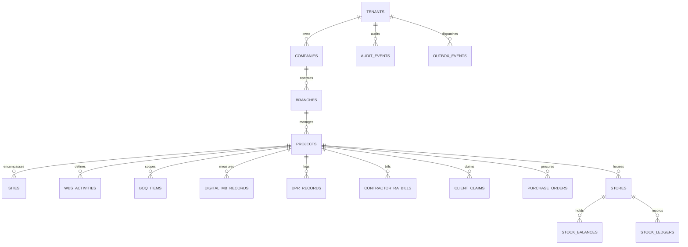

# DEZOBUILD — Relational Database Architecture & Schema Design (v1)

```text
================================================================================
Document ID     : ARCH-DEZ-003
Milestone       : BACKEND ARCHITECTURE BASELINE v1
Status          : AUTHORITATIVE BASELINE — FROZEN FOR IMPLEMENTATION
Scope           : PostgreSQL Relational Data Model, Indexing & Prisma Specifications
================================================================================
```

---

## 1. Relational Architecture & Normalization Principles

The DEZOBUILD database is designed for **PostgreSQL 16+** managed through **Prisma ORM**. It adheres to strict third normal form (3NF) for transactional and master entities, augmented with immutable append-only ledgers for stock, financial audits, and outbox messaging.



### 1.1 Data Classification Matrix

| Table Category | Mutation Characteristic | Concurrency / Locking Strategy | Purge / Retention Policy | Example Tables |
| :--- | :--- | :--- | :--- | :--- |
| **Master / Reference** | Infrequent updates by authorized admins | Optimistic locking (`version` field) | Soft-delete (`deleted_at` timestamp) | `tenants`, `companies`, `materials`, `vendors`, `employees`, `roles` |
| **Transactional Operational** | High-frequency workflow state transitions | Row-level locking (`SELECT ... FOR UPDATE`) + state validation | Business closeout (`archived_at`) | `projects`, `dpr_records`, `purchase_orders`, `grn_records`, `expenses`, `contractor_ra_bills` |
| **Immutable Ledgers** | Append-only insert, zero in-place updates | Primary key UUID sequence | Indefinite statutory retention (7+ years) | `stock_ledgers`, `advance_recovery_logs`, `audit_events`, `mb_verification_logs` |
| **Configuration & Policy** | Tenant/Company specific policy parameters | Optimistic locking | Soft-delete / Version history | `approval_rules`, `alert_rules`, `tenant_settings`, `plan_features` |
| **Event & Queue Outbox** | High-throughput insert, polled update | Skip locked worker queries (`FOR UPDATE SKIP LOCKED`) | Processed event archiving (30-90 days) | `outbox_events`, `report_executions` |

---

## 2. Comprehensive Relational Schema Specification

### 2.1 Identity, Tenancy & Enterprise Hierarchy

```prisma
// ==========================================
// 1. TENANCY & ENTERPRISE MASTER
// ==========================================

model Tenant {
  id              String      @id @default(uuid()) @db.Uuid
  code            String      @unique @db.VarChar(50)
  name            String      @db.VarChar(255)
  domain          String?     @unique @db.VarChar(255)
  status          String      @default("ACTIVE") @db.VarChar(50) // ACTIVE, SUSPENDED, DELINQUENT
  planTier        String      @default("ENTERPRISE") @db.VarChar(50)
  currency        String      @default("INR") @db.VarChar(10)
  currencySymbol  String      @default("₹") @db.VarChar(10)
  timezone        String      @default("Asia/Kolkata") @db.VarChar(100)
  createdAt       DateTime    @default(now()) @db.Timestamptz
  updatedAt       DateTime    @updatedAt @db.Timestamptz
  deletedAt       DateTime?   @db.Timestamptz

  companies       Company[]
  users           User[]
  roles           Role[]
  departments     Department[]
  subscriptions   TenantSubscription[]
  auditEvents     AuditEvent[]
  outboxEvents    OutboxEvent[]

  @@map("tenants")
  @@index([status])
}

model Company {
  id              String      @id @default(uuid()) @db.Uuid
  tenantId        String      @db.Uuid
  code            String      @db.VarChar(50)
  name            String      @db.VarChar(255)
  legalName       String      @db.VarChar(255)
  cinNumber       String?     @db.VarChar(50)
  panNumber       String      @db.VarChar(50)
  gstin           String      @db.VarChar(50)
  email           String      @db.VarChar(255)
  phone           String      @db.VarChar(50)
  address         String      @db.Text
  city            String      @db.VarChar(100)
  state           String      @db.VarChar(100)
  pincode         String      @db.VarChar(20)
  status          String      @default("ACTIVE") @db.VarChar(50)
  createdAt       DateTime    @default(now()) @db.Timestamptz
  updatedAt       DateTime    @updatedAt @db.Timestamptz

  tenant          Tenant      @relation(fields: [tenantId], references: [id], onDelete: Restrict)
  branches        Branch[]
  projects        Project[]

  @@unique([tenantId, code])
  @@map("companies")
  @@index([tenantId])
}

model Branch {
  id              String      @id @default(uuid()) @db.Uuid
  tenantId        String      @db.Uuid
  companyId       String      @db.Uuid
  code            String      @db.VarChar(50)
  name            String      @db.VarChar(255)
  gstin           String      @db.VarChar(50)
  city            String      @db.VarChar(100)
  state           String      @db.VarChar(100)
  status          String      @default("ACTIVE") @db.VarChar(50)
  createdAt       DateTime    @default(now()) @db.Timestamptz
  updatedAt       DateTime    @updatedAt @db.Timestamptz

  company         Company     @relation(fields: [companyId], references: [id], onDelete: Restrict)
  projects        Project[]
  stores          Store[]

  @@unique([tenantId, companyId, code])
  @@map("branches")
  @@index([tenantId, companyId])
}

model Department {
  id              String      @id @default(uuid()) @db.Uuid
  tenantId        String      @db.Uuid
  name            String      @db.VarChar(100)
  code            String      @db.VarChar(50)
  description     String?     @db.VarChar(255)
  createdAt       DateTime    @default(now()) @db.Timestamptz
  updatedAt       DateTime    @updatedAt @db.Timestamptz

  tenant          Tenant      @relation(fields: [tenantId], references: [id], onDelete: Cascade)
  employees       Employee[]

  @@unique([tenantId, code])
  @@map("departments")
  @@index([tenantId])
}
```

---

### 2.2 Identity, Sessions & RBAC

```prisma
// ==========================================
// 2. IDENTITY, SESSIONS & RBAC
// ==========================================

model User {
  id              String      @id @default(uuid()) @db.Uuid
  tenantId        String      @db.Uuid
  email           String      @db.VarChar(255)
  phone           String?     @db.VarChar(50)
  fullName        String      @db.VarChar(255)
  passwordHash    String      @db.VarChar(255)
  status          String      @default("ACTIVE") @db.VarChar(50) // ACTIVE, SUSPENDED, INVITED
  sessionVersion  Int         @default(1)
  employeeId      String?     @unique @db.Uuid // Optional 1:0..1 relationship
  createdAt       DateTime    @default(now()) @db.Timestamptz
  updatedAt       DateTime    @updatedAt @db.Timestamptz
  lastLoginAt     DateTime?   @db.Timestamptz

  tenant          Tenant      @relation(fields: [tenantId], references: [id], onDelete: Restrict)
  employee        Employee?   @relation(fields: [employeeId], references: [id], onDelete: SetNull)
  sessions        Session[]
  roleAssignments UserRoleAssignment[]
  projectMembers  ProjectMember[]

  @@unique([tenantId, email])
  @@map("users")
  @@index([tenantId, status])
}

model Session {
  id              String      @id @default(uuid()) @db.Uuid
  tenantId        String      @db.Uuid
  userId          String      @db.Uuid
  refreshTokenHash String     @db.VarChar(255)
  userAgent       String?     @db.VarChar(500)
  ipAddress       String?     @db.VarChar(50)
  version         Int         @default(1)
  expiresAt       DateTime    @db.Timestamptz
  createdAt       DateTime    @default(now()) @db.Timestamptz
  revokedAt       DateTime?   @db.Timestamptz

  user            User        @relation(fields: [userId], references: [id], onDelete: Cascade)

  @@map("sessions")
  @@index([tenantId, userId, expiresAt])
  @@index([refreshTokenHash])
}

model Role {
  id              String      @id @default(uuid()) @db.Uuid
  tenantId        String      @db.Uuid
  name            String      @db.VarChar(100) // COMPANY_OWNER, PROJECT_MANAGER, etc.
  description     String?     @db.VarChar(255)
  isSystemRole    Boolean     @default(true)
  createdAt       DateTime    @default(now()) @db.Timestamptz
  updatedAt       DateTime    @updatedAt @db.Timestamptz

  tenant          Tenant      @relation(fields: [tenantId], references: [id], onDelete: Cascade)
  assignments     UserRoleAssignment[]
  permissions     RolePermissionMapping[]

  @@unique([tenantId, name])
  @@map("roles")
}

model Permission {
  id              String      @id @default(uuid()) @db.Uuid
  name            String      @unique @db.VarChar(100) // e.g. finance:expense:approve
  module          String      @db.VarChar(50)
  description     String?     @db.VarChar(255)

  roles           RolePermissionMapping[]

  @@map("permissions")
}

model RolePermissionMapping {
  roleId          String      @db.Uuid
  permissionId    String      @db.Uuid

  role            Role        @relation(fields: [roleId], references: [id], onDelete: Cascade)
  permission      Permission  @relation(fields: [permissionId], references: [id], onDelete: Cascade)

  @@id([roleId, permissionId])
  @@map("role_permissions")
}

model UserRoleAssignment {
  id              String      @id @default(uuid()) @db.Uuid
  tenantId        String      @db.Uuid
  userId          String      @db.Uuid
  roleId          String      @db.Uuid
  scopeType       String      @default("TENANT") @db.VarChar(50) // TENANT, COMPANY, PROJECT
  scopeId         String?     @db.Uuid
  createdAt       DateTime    @default(now()) @db.Timestamptz

  user            User        @relation(fields: [userId], references: [id], onDelete: Cascade)
  role            Role        @relation(fields: [roleId], references: [id], onDelete: Cascade)

  @@unique([tenantId, userId, roleId, scopeType, scopeId])
  @@map("user_role_assignments")
  @@index([tenantId, userId])
}
```

---

### 2.3 Subscriptions & Plan Catalog

```prisma
// ==========================================
// 3. SUBSCRIPTIONS & ENTITLEMENTS
// ==========================================

model PlatformPlan {
  id              String      @id @default(uuid()) @db.Uuid
  code            String      @unique @db.VarChar(50) // STARTER, PROFESSIONAL, ENTERPRISE
  name            String      @db.VarChar(100)
  description     String?     @db.VarChar(255)
  maxProjects     Int         @default(2) // 2, 10, -1 (unlimited)
  maxStorageGb    Int         @default(50)
  maxSeats        Int         @default(15)
  priceMonthly    Decimal     @db.Decimal(12, 2)
  priceAnnual     Decimal     @db.Decimal(12, 2)
  isActive        Boolean     @default(true)
  createdAt       DateTime    @default(now()) @db.Timestamptz

  features        PlanFeature[]
  subscriptions   TenantSubscription[]

  @@map("platform_plans")
}

model PlanFeature {
  id              String        @id @default(uuid()) @db.Uuid
  planId          String        @db.Uuid
  featureKey      String        @db.VarChar(100) // e.g. ADVANCED_ANALYTICS, BIOMETRIC_SYNC
  isEnabled       Boolean       @default(true)

  plan            PlatformPlan  @relation(fields: [planId], references: [id], onDelete: Cascade)

  @@unique([planId, featureKey])
  @@map("plan_features")
}

model TenantSubscription {
  id              String        @id @default(uuid()) @db.Uuid
  tenantId        String        @db.Uuid
  planId          String        @db.Uuid
  status          String        @default("ACTIVE") @db.VarChar(50) // ACTIVE, PAST_DUE, CANCELLED
  billingCycle    String        @default("ANNUAL") @db.VarChar(20)
  currentPeriodStart DateTime   @db.Timestamptz
  currentPeriodEnd   DateTime   @db.Timestamptz
  cancelAtPeriodEnd  Boolean    @default(false)
  createdAt       DateTime      @default(now()) @db.Timestamptz
  updatedAt       DateTime      @updatedAt @db.Timestamptz

  tenant          Tenant        @relation(fields: [tenantId], references: [id], onDelete: Restrict)
  plan            PlatformPlan  @relation(fields: [planId], references: [id], onDelete: Restrict)

  @@map("tenant_subscriptions")
  @@index([tenantId, status])
}
```

---

### 2.4 Projects, WBS & Daily Progress (DPR)

```prisma
// ==========================================
// 4. PROJECTS, WBS & PROGRESS (DPR)
// ==========================================

model Project {
  id                  String         @id @default(uuid()) @db.Uuid
  tenantId            String         @db.Uuid
  companyId           String         @db.Uuid
  branchId            String?        @db.Uuid
  code                String         @db.VarChar(50)
  name                String         @db.VarChar(255)
  clientName          String         @db.VarChar(255)
  location            String         @db.VarChar(255)
  address             String         @db.Text
  city                String         @db.VarChar(100)
  state               String         @db.VarChar(100)
  startDate           DateTime       @db.Date
  targetCompletion    DateTime       @db.Date
  status              String         @default("active") @db.VarChar(50) // active, planning, completed, archived
  health              String         @default("healthy") @db.VarChar(50) // critical, attention, healthy
  budget              Decimal        @db.Decimal(15, 2)
  actualCost          Decimal        @default(0) @db.Decimal(15, 2)
  committedCost       Decimal        @default(0) @db.Decimal(15, 2)
  progress            Float          @default(0) // 0-100
  plannedProgress     Float          @default(0)
  siteArea            String?        @db.VarChar(100)
  builtUpArea         String?        @db.VarChar(100)
  description         String?        @db.Text
  version             Int            @default(1)
  createdAt           DateTime       @default(now()) @db.Timestamptz
  updatedAt           DateTime       @updatedAt @db.Timestamptz
  archivedAt          DateTime?      @db.Timestamptz

  company             Company        @relation(fields: [companyId], references: [id], onDelete: Restrict)
  members             ProjectMember[]
  wbsActivities       WbsActivity[]
  dprRecords          DprRecord[]
  boqItems            BoqItem[]
  digitalMbRecords    DigitalMbRecord[]
  purchaseOrders      PurchaseOrder[]
  materialIndents     MaterialIndent[]
  contractorRaBills   ContractorRaBill[]
  clientClaims        ClientClaim[]
  expenses            Expense[]
  paymentVouchers     PaymentVoucher[]
  advances            Advance[]
  stores              Store[]
  pourCards           PourCard[]
  ncrs                NcrRecord[]
  safetyWalkthroughs  SafetyWalkthrough[]
  safetyIncidents     SafetyIncident[]
  drawingRecords      DrawingRecord[]
  rfiRecords          RfiRecord[]
  smartAlerts         SmartAlert[]

  @@unique([tenantId, code])
  @@map("projects")
  @@index([tenantId, status])
  @@index([tenantId, companyId])
}

model ProjectMember {
  id              String      @id @default(uuid()) @db.Uuid
  tenantId        String      @db.Uuid
  projectId       String      @db.Uuid
  userId          String      @db.Uuid
  projectRole     String      @db.VarChar(100) // Project Manager, Site Engineer, etc.
  isLead          Boolean     @default(false)
  joinedAt        DateTime    @default(now()) @db.Timestamptz

  project         Project     @relation(fields: [projectId], references: [id], onDelete: Cascade)
  user            User        @relation(fields: [userId], references: [id], onDelete: Cascade)

  @@unique([projectId, userId])
  @@map("project_members")
  @@index([tenantId, userId])
}

model WbsActivity {
  id              String          @id @default(uuid()) @db.Uuid
  tenantId        String          @db.Uuid
  projectId       String          @db.Uuid
  parentId        String?         @db.Uuid
  code            String          @db.VarChar(50)
  name            String          @db.VarChar(255)
  category        String          @db.VarChar(100) // Substructure, Superstructure, Finishes, MEP, External Works
  unit            String          @db.VarChar(50)
  plannedQty      Float           @default(0)
  actualQty       Float           @default(0)
  plannedRate     Decimal         @default(0) @db.Decimal(12, 2)
  actualRate      Decimal         @default(0) @db.Decimal(12, 2)
  plannedCost     Decimal         @default(0) @db.Decimal(15, 2)
  actualCost      Decimal         @default(0) @db.Decimal(15, 2)
  plannedProgress Float           @default(0)
  actualProgress  Float           @default(0)
  startDate       DateTime        @db.Date
  endDate         DateTime        @db.Date
  status          String          @default("not_started") @db.VarChar(50)
  assignedGang    String?         @db.VarChar(255)
  createdAt       DateTime        @default(now()) @db.Timestamptz
  updatedAt       DateTime        @updatedAt @db.Timestamptz

  project         Project         @relation(fields: [projectId], references: [id], onDelete: Cascade)
  parent          WbsActivity?    @relation("WbsHierarchy", fields: [parentId], references: [id], onDelete: Restrict)
  children        WbsActivity[]   @relation("WbsHierarchy")
  dprItems        DprProgressItem[]
  boqItems        BoqItem[]
  materialIssues  MaterialIssue[]

  @@unique([projectId, code])
  @@map("wbs_activities")
  @@index([tenantId, projectId, status])
}

model DprRecord {
  id              String            @id @default(uuid()) @db.Uuid
  tenantId        String            @db.Uuid
  projectId       String            @db.Uuid
  dprNumber       String            @db.VarChar(50)
  date            DateTime          @db.Date
  weather         String            @db.VarChar(50) // sunny, cloudy, rainy, windy
  temperature     String?           @db.VarChar(50)
  shift           String            @default("General Shift (8 AM - 6 PM)") @db.VarChar(100)
  safetyRemarks   String?           @db.Text
  delaysObstacles String?           @db.Text
  submittedById   String            @db.Uuid
  status          String            @default("draft") @db.VarChar(50) // draft, submitted, approved, rejected
  createdAt       DateTime          @default(now()) @db.Timestamptz
  updatedAt       DateTime          @updatedAt @db.Timestamptz

  project         Project           @relation(fields: [projectId], references: [id], onDelete: Cascade)
  manpower        DprManpower[]
  equipment       DprEquipment[]
  materials       DprMaterial[]
  progressItems   DprProgressItem[]
  photos          DprPhoto[]

  @@unique([tenantId, dprNumber])
  @@unique([projectId, date, shift])
  @@map("dpr_records")
  @@index([tenantId, projectId, date])
}

model DprManpower {
  id              String      @id @default(uuid()) @db.Uuid
  dprId           String      @db.Uuid
  trade           String      @db.VarChar(100)
  skilled         Int         @default(0)
  unskilled       Int         @default(0)
  supervisor      Int         @default(0)

  dpr             DprRecord   @relation(fields: [dprId], references: [id], onDelete: Cascade)

  @@map("dpr_manpower")
}

model DprEquipment {
  id              String      @id @default(uuid()) @db.Uuid
  dprId           String      @db.Uuid
  name            String      @db.VarChar(255)
  hours           Float       @default(0)
  status          String      @db.VarChar(50) // running, idle, breakdown

  dpr             DprRecord   @relation(fields: [dprId], references: [id], onDelete: Cascade)

  @@map("dpr_equipment")
}

model DprMaterial {
  id              String      @id @default(uuid()) @db.Uuid
  dprId           String      @db.Uuid
  materialName    String      @db.VarChar(255)
  quantity        Float       @default(0)
  unit            String      @db.VarChar(50)

  dpr             DprRecord   @relation(fields: [dprId], references: [id], onDelete: Cascade)

  @@map("dpr_materials")
}

model DprProgressItem {
  id                  String      @id @default(uuid()) @db.Uuid
  dprId               String      @db.Uuid
  activityId          String      @db.Uuid
  workCompleted       String      @db.Text
  quantityDone        Float       @default(0)
  unit                String      @db.VarChar(50)
  progressPercentage  Float       @default(0)

  dpr                 DprRecord   @relation(fields: [dprId], references: [id], onDelete: Cascade)
  activity            WbsActivity @relation(fields: [activityId], references: [id], onDelete: Restrict)

  @@map("dpr_progress_items")
}

model DprPhoto {
  id              String      @id @default(uuid()) @db.Uuid
  dprId           String      @db.Uuid
  url             String      @db.VarChar(1000)
  caption         String?     @db.VarChar(255)
  timestamp       DateTime    @default(now()) @db.Timestamptz

  dpr             DprRecord   @relation(fields: [dprId], references: [id], onDelete: Cascade)

  @@map("dpr_photos")
}
```

---

### 2.5 BOQ, Digital Measurement Book & RA Billing

```prisma
// ==========================================
// 5. BOQ, MEASUREMENT BOOK & BILLING
// ==========================================

model BoqItem {
  id              String            @id @default(uuid()) @db.Uuid
  tenantId        String            @db.Uuid
  projectId       String            @db.Uuid
  wbsActivityId   String?           @db.Uuid
  itemNumber      String            @db.VarChar(50)
  description     String            @db.Text
  unit            String            @db.VarChar(50)
  quantity        Float
  rate            Decimal           @db.Decimal(12, 2)
  amount          Decimal           @db.Decimal(15, 2)
  executedQty     Float             @default(0)
  createdAt       DateTime          @default(now()) @db.Timestamptz
  updatedAt       DateTime          @updatedAt @db.Timestamptz

  project         Project           @relation(fields: [projectId], references: [id], onDelete: Cascade)
  wbsActivity     WbsActivity?      @relation(fields: [wbsActivityId], references: [id], onDelete: SetNull)
  measurements    DigitalMbRecord[]

  @@unique([projectId, itemNumber])
  @@map("boq_items")
  @@index([tenantId, projectId])
}

model DigitalMbRecord {
  id                  String        @id @default(uuid()) @db.Uuid
  tenantId            String        @db.Uuid
  projectId           String        @db.Uuid
  boqItemId           String        @db.Uuid
  wbsActivityId       String        @db.Uuid
  mbNumber            String        @db.VarChar(50)
  date                DateTime      @db.Date
  measurementType     String        @db.VarChar(100) // Length × Breadth × Depth, Area, Volume, etc.
  location            String        @db.VarChar(255)
  description         String        @db.Text
  unit                String        @db.VarChar(50)
  calculatedQty       Float         @default(0)
  previousQty         Float         @default(0)
  currentQty          Float         @default(0)
  cumulativeQty       Float         @default(0)
  verificationStatus  String        @default("pending") @db.VarChar(50) // pending, verified, rejected
  verifiedById        String?       @db.Uuid
  verifiedAt          DateTime?     @db.Timestamptz
  notes               String?       @db.Text
  createdAt           DateTime      @default(now()) @db.Timestamptz

  project             Project       @relation(fields: [projectId], references: [id], onDelete: Cascade)
  boqItem             BoqItem       @relation(fields: [boqItemId], references: [id], onDelete: Restrict)
  dimensions          MeasurementDimension[]

  @@unique([tenantId, mbNumber])
  @@map("digital_mb_records")
  @@index([tenantId, projectId, verificationStatus])
}

model MeasurementDimension {
  id              String          @id @default(uuid()) @db.Uuid
  mbRecordId      String          @db.Uuid
  length          Float           @default(0)
  breadth         Float           @default(0)
  depth           Float           @default(0)
  count           Float           @default(1)
  customFactor    Float           @default(1)

  mbRecord        DigitalMbRecord @relation(fields: [mbRecordId], references: [id], onDelete: Cascade)

  @@map("measurement_dimensions")
}

model ContractorRaBill {
  id                  String        @id @default(uuid()) @db.Uuid
  tenantId            String        @db.Uuid
  projectId           String        @db.Uuid
  contractorId        String        @db.Uuid
  billNumber          String        @db.VarChar(50)
  billingPeriod       String        @db.VarChar(100)
  measurementRef      String?       @db.VarChar(255)
  grossBill           Decimal       @db.Decimal(15, 2)
  retentionPercent    Float         @default(5)
  retentionAmount     Decimal       @db.Decimal(15, 2)
  advanceRecovery     Decimal       @default(0) @db.Decimal(15, 2)
  tdsPercent          Float         @default(2)
  tdsAmount           Decimal       @db.Decimal(15, 2)
  labourCessPercent   Float         @default(1)
  labourCessAmount    Decimal       @db.Decimal(15, 2)
  otherDeductions     Decimal       @default(0) @db.Decimal(15, 2)
  netPayable          Decimal       @db.Decimal(15, 2)
  status              String        @default("draft") @db.VarChar(50) // draft, submitted, verified, approved, payable, paid
  submittedDate       DateTime      @db.Date
  approvedDate        DateTime?     @db.Date
  paidDate            DateTime?     @db.Date
  version             Int           @default(1)
  createdAt           DateTime      @default(now()) @db.Timestamptz
  updatedAt           DateTime      @updatedAt @db.Timestamptz

  project             Project       @relation(fields: [projectId], references: [id], onDelete: Restrict)
  contractor          Contractor    @relation(fields: [contractorId], references: [id], onDelete: Restrict)

  @@unique([tenantId, billNumber])
  @@map("contractor_ra_bills")
  @@index([tenantId, projectId, status])
}

model ClientClaim {
  id                  String        @id @default(uuid()) @db.Uuid
  tenantId            String        @db.Uuid
  projectId           String        @db.Uuid
  claimNumber         String        @db.VarChar(50)
  claimPeriod         String        @db.VarChar(100)
  cumulativeWork      Decimal       @db.Decimal(15, 2)
  previousCertified   Decimal       @db.Decimal(15, 2)
  currentClaim        Decimal       @db.Decimal(15, 2)
  grossClaim          Decimal       @db.Decimal(15, 2)
  gstPercent          Float         @default(18)
  gstAmount           Decimal       @db.Decimal(15, 2)
  netClaim            Decimal       @db.Decimal(15, 2)
  status              String        @default("draft") @db.VarChar(50) // draft, submitted, certified, receivable, received
  submittedDate       DateTime      @db.Date
  certifiedDate       DateTime?     @db.Date
  version             Int           @default(1)
  createdAt           DateTime      @default(now()) @db.Timestamptz
  updatedAt           DateTime      @updatedAt @db.Timestamptz

  project             Project       @relation(fields: [projectId], references: [id], onDelete: Restrict)

  @@unique([tenantId, claimNumber])
  @@map("client_claims")
  @@index([tenantId, projectId, status])
}
```

---

### 2.6 Materials, Stores & Physical Stock Ledgers

```prisma
// ==========================================
// 6. MATERIALS, STORES & STOCK LEDGERS
// ==========================================

model MaterialItem {
  id                  String              @id @default(uuid()) @db.Uuid
  tenantId            String              @db.Uuid
  code                String              @db.VarChar(50)
  name                String              @db.VarChar(255)
  category            String              @db.VarChar(100) // Cement, Steel, Aggregates, Masonry, Finishing, MEP, Consumables
  unit                String              @db.VarChar(50)
  reorderLevel        Float               @default(0)
  safetyStock         Float               @default(0)
  unitRate            Decimal             @db.Decimal(12, 2)
  specification       String?             @db.Text
  status              String              @default("healthy") @db.VarChar(50) // healthy, attention, critical
  createdAt           DateTime            @default(now()) @db.Timestamptz
  updatedAt           DateTime            @updatedAt @db.Timestamptz

  stockBalances       StockBalance[]
  stockLedgers        StockLedger[]
  indentItems         IndentItem[]
  poItems             PurchaseOrderItem[]
  grnItems            GrnItem[]
  issueItems          MaterialIssueItem[]
  returnItems         MaterialReturnItem[]
  transferItems       StockTransferItem[]

  @@unique([tenantId, code])
  @@map("materials")
  @@index([tenantId, category])
}

model Store {
  id                  String              @id @default(uuid()) @db.Uuid
  tenantId            String              @db.Uuid
  branchId            String?             @db.Uuid
  projectId           String?             @db.Uuid
  code                String              @db.VarChar(50)
  name                String              @db.VarChar(255)
  isCentralWarehouse  Boolean             @default(false)
  location            String              @db.VarChar(255)
  status              String              @default("ACTIVE") @db.VarChar(50)
  createdAt           DateTime            @default(now()) @db.Timestamptz
  updatedAt           DateTime            @updatedAt @db.Timestamptz

  branch              Branch?             @relation(fields: [branchId], references: [id], onDelete: SetNull)
  project             Project?            @relation(fields: [projectId], references: [id], onDelete: SetNull)
  stockBalances       StockBalance[]
  stockLedgers        StockLedger[]
  dispatchedTransfers StockTransfer[]     @relation("SourceStore")
  receivedTransfers   StockTransfer[]     @relation("DestinationStore")

  @@unique([tenantId, code])
  @@map("stores")
  @@index([tenantId, projectId])
}

model StockBalance {
  id                  String              @id @default(uuid()) @db.Uuid
  tenantId            String              @db.Uuid
  storeId             String              @db.Uuid
  materialId          String              @db.Uuid
  currentStock        Float               @default(0)
  reservedStock       Float               @default(0)
  totalStockValue     Decimal             @default(0) @db.Decimal(15, 2)
  lastMovementAt      DateTime?           @db.Timestamptz
  version             Int                 @default(1)

  store               Store               @relation(fields: [storeId], references: [id], onDelete: Cascade)
  material            MaterialItem        @relation(fields: [materialId], references: [id], onDelete: Restrict)

  @@unique([storeId, materialId])
  @@map("stock_balances")
  @@index([tenantId, materialId])
}

model StockLedger {
  id                  String              @id @default(uuid()) @db.Uuid
  tenantId            String              @db.Uuid
  storeId             String              @db.Uuid
  materialId          String              @db.Uuid
  transactionType     String              @db.VarChar(50) // RECEIPT_GRN, ISSUE_WBS, TRANSFER_OUT, TRANSFER_IN, RETURN_SCRAP, RECONCILIATION
  referenceDocumentType String            @db.VarChar(50) // GRN, ISSUE, TRANSFER, RETURN
  referenceDocumentId   String            @db.Uuid
  quantityChange      Float               // positive for receipt/return, negative for issue/dispatch
  balanceAfter        Float
  unitRate            Decimal             @db.Decimal(12, 2)
  totalValue          Decimal             @db.Decimal(15, 2)
  actorId             String              @db.Uuid
  createdAt           DateTime            @default(now()) @db.Timestamptz

  store               Store               @relation(fields: [storeId], references: [id], onDelete: Restrict)
  material            MaterialItem        @relation(fields: [materialId], references: [id], onDelete: Restrict)

  @@map("stock_ledgers")
  @@index([tenantId, storeId, materialId, createdAt])
  @@index([referenceDocumentType, referenceDocumentId])
}

model MaterialIndent {
  id                  String              @id @default(uuid()) @db.Uuid
  tenantId            String              @db.Uuid
  projectId           String              @db.Uuid
  indentNumber        String              @db.VarChar(50)
  requestedById       String              @db.Uuid
  requiredDate        DateTime            @db.Date
  priority            String              @default("normal") @db.VarChar(50) // normal, urgent, critical
  status              String              @default("draft") @db.VarChar(50) // draft, submitted, approved, rejected, ordered
  notes               String?             @db.Text
  createdAt           DateTime            @default(now()) @db.Timestamptz
  updatedAt           DateTime            @updatedAt @db.Timestamptz

  project             Project             @relation(fields: [projectId], references: [id], onDelete: Cascade)
  items               IndentItem[]
  purchaseOrders      PurchaseOrder[]

  @@unique([tenantId, indentNumber])
  @@map("material_indents")
  @@index([tenantId, projectId, status])
}

model IndentItem {
  id                  String              @id @default(uuid()) @db.Uuid
  indentId            String              @db.Uuid
  materialId          String              @db.Uuid
  quantity            Float
  unit                String              @db.VarChar(50)
  purpose             String?             @db.VarChar(255)

  indent              MaterialIndent      @relation(fields: [indentId], references: [id], onDelete: Cascade)
  material            MaterialItem        @relation(fields: [materialId], references: [id], onDelete: Restrict)

  @@map("indent_items")
}

model Vendor {
  id                  String              @id @default(uuid()) @db.Uuid
  tenantId            String              @db.Uuid
  name                String              @db.VarChar(255)
  category            String              @db.VarChar(100)
  contactPerson       String              @db.VarChar(255)
  phone               String              @db.VarChar(50)
  email               String              @db.VarChar(255)
  gstin               String              @db.VarChar(50)
  address             String              @db.Text
  rating              Float               @default(5.0)
  status              String              @default("active") @db.VarChar(50) // active, blocked
  createdAt           DateTime            @default(now()) @db.Timestamptz
  updatedAt           DateTime            @updatedAt @db.Timestamptz

  purchaseOrders      PurchaseOrder[]

  @@unique([tenantId, gstin])
  @@map("vendors")
  @@index([tenantId, status])
}

model PurchaseOrder {
  id                  String              @id @default(uuid()) @db.Uuid
  tenantId            String              @db.Uuid
  projectId           String              @db.Uuid
  indentId            String?             @db.Uuid
  vendorId            String              @db.Uuid
  poNumber            String              @db.VarChar(50)
  totalAmount         Decimal             @db.Decimal(15, 2)
  taxAmount           Decimal             @db.Decimal(15, 2)
  grandTotal          Decimal             @db.Decimal(15, 2)
  issueDate           DateTime            @db.Date
  expectedDelivery    DateTime            @db.Date
  paymentTerms        String?             @db.VarChar(255)
  status              String              @default("draft") @db.VarChar(50) // draft, issued, partially_received, delivered, cancelled
  version             Int                 @default(1)
  createdAt           DateTime            @default(now()) @db.Timestamptz
  updatedAt           DateTime            @updatedAt @db.Timestamptz

  project             Project             @relation(fields: [projectId], references: [id], onDelete: Restrict)
  indent              MaterialIndent?     @relation(fields: [indentId], references: [id], onDelete: SetNull)
  vendor              Vendor              @relation(fields: [vendorId], references: [id], onDelete: Restrict)
  items               PurchaseOrderItem[]
  grnRecords          GrnRecord[]

  @@unique([tenantId, poNumber])
  @@map("purchase_orders")
  @@index([tenantId, projectId, status])
}

model PurchaseOrderItem {
  id                  String              @id @default(uuid()) @db.Uuid
  poId                String              @db.Uuid
  materialId          String              @db.Uuid
  quantity            Float
  unit                String              @db.VarChar(50)
  rate                Decimal             @db.Decimal(12, 2)
  amount              Decimal             @db.Decimal(15, 2)
  receivedQty         Float               @default(0)

  purchaseOrder       PurchaseOrder       @relation(fields: [poId], references: [id], onDelete: Cascade)
  material            MaterialItem        @relation(fields: [materialId], references: [id], onDelete: Restrict)

  @@map("purchase_order_items")
}

model GrnRecord {
  id                  String              @id @default(uuid()) @db.Uuid
  tenantId            String              @db.Uuid
  projectId           String              @db.Uuid
  poId                String              @db.Uuid
  storeId             String              @db.Uuid
  grnNumber           String              @db.VarChar(50)
  challanNumber       String              @db.VarChar(100)
  invoiceNumber       String              @db.VarChar(100)
  date                DateTime            @db.Date
  vehicleNo           String?             @db.VarChar(50)
  receivedById        String              @db.Uuid
  status              String              @default("draft") @db.VarChar(50) // draft, verified, flagged
  createdAt           DateTime            @default(now()) @db.Timestamptz
  updatedAt           DateTime            @updatedAt @db.Timestamptz

  purchaseOrder       PurchaseOrder       @relation(fields: [poId], references: [id], onDelete: Restrict)
  items               GrnItem[]

  @@unique([tenantId, grnNumber])
  @@map("grn_records")
  @@index([tenantId, projectId, status])
}

model GrnItem {
  id                  String              @id @default(uuid()) @db.Uuid
  grnId               String              @db.Uuid
  materialId          String              @db.Uuid
  orderedQty          Float
  receivedQty         Float
  acceptedQty         Float
  rejectedQty         Float               @default(0)
  unit                String              @db.VarChar(50)
  rejectionReason     String?             @db.VarChar(255)

  grn                 GrnRecord           @relation(fields: [grnId], references: [id], onDelete: Cascade)
  material            MaterialItem        @relation(fields: [materialId], references: [id], onDelete: Restrict)

  @@map("grn_items")
}

model MaterialIssue {
  id                  String              @id @default(uuid()) @db.Uuid
  tenantId            String              @db.Uuid
  projectId           String              @db.Uuid
  wbsActivityId       String              @db.Uuid
  storeId             String              @db.Uuid
  issueNumber         String              @db.VarChar(50)
  requisitionNo       String?             @db.VarChar(50)
  issuedTo            String              @db.VarChar(255)
  issuedById          String              @db.Uuid
  date                DateTime            @db.Date
  createdAt           DateTime            @default(now()) @db.Timestamptz

  wbsActivity         WbsActivity         @relation(fields: [wbsActivityId], references: [id], onDelete: Restrict)
  items               MaterialIssueItem[]

  @@unique([tenantId, issueNumber])
  @@map("material_issues")
  @@index([tenantId, projectId])
}

model MaterialIssueItem {
  id                  String              @id @default(uuid()) @db.Uuid
  issueId             String              @db.Uuid
  materialId          String              @db.Uuid
  quantity            Float
  unit                String              @db.VarChar(50)

  issue               MaterialIssue       @relation(fields: [issueId], references: [id], onDelete: Cascade)
  material            MaterialItem        @relation(fields: [materialId], references: [id], onDelete: Restrict)

  @@map("material_issue_items")
}

model StockTransfer {
  id                      String              @id @default(uuid()) @db.Uuid
  tenantId                String              @db.Uuid
  transferNumber          String              @db.VarChar(50)
  sourceStoreId           String              @db.Uuid
  destinationStoreId      String              @db.Uuid
  dispatchDate            DateTime            @db.Date
  arrivalDate             DateTime?           @db.Date
  driverContact           String?             @db.VarChar(100)
  status                  String              @default("in_transit") @db.VarChar(50) // in_transit, received, cancelled
  createdAt               DateTime            @default(now()) @db.Timestamptz
  updatedAt               DateTime            @updatedAt @db.Timestamptz

  sourceStore             Store               @relation("SourceStore", fields: [sourceStoreId], references: [id], onDelete: Restrict)
  destinationStore        Store               @relation("DestinationStore", fields: [destinationStoreId], references: [id], onDelete: Restrict)
  items                   StockTransferItem[]

  @@unique([tenantId, transferNumber])
  @@map("stock_transfers")
  @@index([tenantId, status])
}

model StockTransferItem {
  id                  String              @id @default(uuid()) @db.Uuid
  transferId          String              @db.Uuid
  materialId          String              @db.Uuid
  quantity            Float
  unit                String              @db.VarChar(50)

  transfer            StockTransfer       @relation(fields: [transferId], references: [id], onDelete: Cascade)
  material            MaterialItem        @relation(fields: [materialId], references: [id], onDelete: Restrict)

  @@map("stock_transfer_items")
}
```

---

### 2.7 Finance, Equipment, Quality, Safety & Outbox

```prisma
// ==========================================
// 7. FINANCE, EXPENSES & ADVANCES
// ==========================================

model Expense {
  id                  String              @id @default(uuid()) @db.Uuid
  tenantId            String              @db.Uuid
  projectId           String              @db.Uuid
  expenseNumber       String              @db.VarChar(50)
  category            String              @db.VarChar(100) // Fuel, Labour Wages, Site Amenities, Equipment Hire, Materials, Permits & Statutory, Miscellaneous
  amount              Decimal             @db.Decimal(15, 2)
  vendorContractor    String              @db.VarChar(255)
  paidById            String              @db.Uuid
  paymentMode         String              @db.VarChar(50) // Petty Cash, Bank Transfer, UPI, Cheque
  date                DateTime            @db.Date
  receiptAttached     Boolean             @default(false)
  receiptName         String?             @db.VarChar(255)
  status              String              @default("draft") @db.VarChar(50) // draft, pending_approval, approved, rejected, paid
  notes               String?             @db.Text
  version             Int                 @default(1)
  createdAt           DateTime            @default(now()) @db.Timestamptz
  updatedAt           DateTime            @updatedAt @db.Timestamptz

  project             Project             @relation(fields: [projectId], references: [id], onDelete: Restrict)

  @@unique([tenantId, expenseNumber])
  @@map("expenses")
  @@index([tenantId, projectId, status])
}

model PaymentVoucher {
  id                  String              @id @default(uuid()) @db.Uuid
  tenantId            String              @db.Uuid
  projectId           String              @db.Uuid
  voucherNumber       String              @db.VarChar(50)
  payeeName           String              @db.VarChar(255)
  payeeType           String              @db.VarChar(50) // Vendor, Contractor, Staff, Utility
  invoiceRef          String?             @db.VarChar(100)
  amount              Decimal             @db.Decimal(15, 2)
  dueDate             DateTime            @db.Date
  paymentDate         DateTime?           @db.Date
  status              String              @default("pending") @db.VarChar(50) // pending, approved, paid, overdue
  paymentMethod       String?             @db.VarChar(50)
  idempotencyKey      String?             @unique @db.VarChar(255)
  createdAt           DateTime            @default(now()) @db.Timestamptz
  updatedAt           DateTime            @updatedAt @db.Timestamptz

  project             Project             @relation(fields: [projectId], references: [id], onDelete: Restrict)

  @@unique([tenantId, voucherNumber])
  @@map("payment_vouchers")
  @@index([tenantId, projectId, status])
}

model Advance {
  id                  String              @id @default(uuid()) @db.Uuid
  tenantId            String              @db.Uuid
  projectId           String              @db.Uuid
  advanceNumber       String              @db.VarChar(50)
  partyName           String              @db.VarChar(255)
  partyType           String              @db.VarChar(50) // Subcontractor, Supplier, Employee
  amount              Decimal             @db.Decimal(15, 2)
  recoveredAmount     Decimal             @default(0) @db.Decimal(15, 2)
  outstandingBalance  Decimal             @db.Decimal(15, 2)
  disbursementDate    DateTime            @db.Date
  recoveryTerms       String?             @db.Text
  status              String              @default("active") @db.VarChar(50) // active, recovered, overdue
  createdAt           DateTime            @default(now()) @db.Timestamptz
  updatedAt           DateTime            @updatedAt @db.Timestamptz

  project             Project             @relation(fields: [projectId], references: [id], onDelete: Restrict)

  @@unique([tenantId, advanceNumber])
  @@map("advances")
  @@index([tenantId, projectId, status])
}

model Contractor {
  id                  String              @id @default(uuid()) @db.Uuid
  tenantId            String              @db.Uuid
  name                String              @db.VarChar(255)
  trade               String              @db.VarChar(100)
  contactPerson       String              @db.VarChar(255)
  phone               String              @db.VarChar(50)
  totalContractValue  Decimal             @default(0) @db.Decimal(15, 2)
  paidToDate          Decimal             @default(0) @db.Decimal(15, 2)
  retentionHeld       Decimal             @default(0) @db.Decimal(15, 2)
  performanceScore    Float               @default(5.0)
  status              String              @default("active") @db.VarChar(50) // active, hold
  createdAt           DateTime            @default(now()) @db.Timestamptz
  updatedAt           DateTime            @updatedAt @db.Timestamptz

  raBills             ContractorRaBill[]

  @@map("contractors")
  @@index([tenantId, status])
}

// ==========================================
// 8. PEOPLE, ATTENDANCE & EQUIPMENT
// ==========================================

model Employee {
  id                  String              @id @default(uuid()) @db.Uuid
  tenantId            String              @db.Uuid
  departmentId        String?             @db.Uuid
  empCode             String              @db.VarChar(50)
  name                String              @db.VarChar(255)
  role                String              @db.VarChar(100)
  assignedSite        String?             @db.VarChar(255)
  phone               String              @db.VarChar(50)
  email               String              @db.VarChar(255)
  status              String              @default("on_site") @db.VarChar(50) // on_site, in_office, on_leave, travelling
  dateOfJoining       DateTime            @db.Date
  createdAt           DateTime            @default(now()) @db.Timestamptz
  updatedAt           DateTime            @updatedAt @db.Timestamptz

  department          Department?         @relation(fields: [departmentId], references: [id], onDelete: SetNull)
  user                User?

  @@unique([tenantId, empCode])
  @@map("employees")
  @@index([tenantId, status])
}

model LabourContractor {
  id                  String              @id @default(uuid()) @db.Uuid
  tenantId            String              @db.Uuid
  name                String              @db.VarChar(255)
  trade               String              @db.VarChar(100)
  assignedProject     String?             @db.VarChar(255)
  currentDeployment   Int                 @default(0)
  plannedDeployment   Int                 @default(0)
  supervisorName      String              @db.VarChar(255)
  phone               String              @db.VarChar(50)
  dailyWageRate       Decimal             @db.Decimal(10, 2)
  status              String              @default("active") @db.VarChar(50)
  createdAt           DateTime            @default(now()) @db.Timestamptz

  @@map("labour_contractors")
}

model AttendanceRecord {
  id                  String              @id @default(uuid()) @db.Uuid
  tenantId            String              @db.Uuid
  projectId           String              @db.Uuid
  date                DateTime            @db.Date
  totalWorkforce      Int                 @default(0)
  totalPresent        Int                 @default(0)
  totalAbsent         Int                 @default(0)
  regularHours        Float               @default(0)
  overtimeHours       Float               @default(0)
  totalWageImpact     Decimal             @default(0) @db.Decimal(15, 2)
  submittedById       String              @db.Uuid
  createdAt           DateTime            @default(now()) @db.Timestamptz

  entries             AttendanceEntry[]

  @@unique([projectId, date])
  @@map("attendance_records")
  @@index([tenantId, projectId, date])
}

model AttendanceEntry {
  id                  String              @id @default(uuid()) @db.Uuid
  attendanceRecordId  String              @db.Uuid
  workerId            String              @db.VarChar(50)
  workerName          String              @db.VarChar(255)
  trade               String              @db.VarChar(100)
  contractorName      String              @db.VarChar(255)
  status              String              @db.VarChar(50) // present, absent, half_day
  hours               Float               @default(8)
  otHours             Float               @default(0)
  wageRate            Decimal             @db.Decimal(10, 2)

  attendanceRecord    AttendanceRecord    @relation(fields: [attendanceRecordId], references: [id], onDelete: Cascade)

  @@map("attendance_entries")
}

model EquipmentAsset {
  id                  String              @id @default(uuid()) @db.Uuid
  tenantId            String              @db.Uuid
  assetCode           String              @db.VarChar(50)
  name                String              @db.VarChar(255)
  type                String              @db.VarChar(100) // Tower Crane, Excavator, Concrete Pump, Batching Plant, Transit Mixer, DG Set, Passenger Hoist
  ownership           String              @db.VarChar(50) // Owned, Rented
  currentSite         String              @db.VarChar(255)
  status              String              @default("running") @db.VarChar(50) // running, idle, breakdown, maintenance
  totalOperatingHours Float               @default(0)
  currentHourMeter    Float               @default(0)
  fuelEfficiencyLph   Float               @default(0)
  hourlyRate          Decimal             @db.Decimal(10, 2)
  nextServiceInHours  Float               @default(250)
  lastServiceDate     DateTime?           @db.Date
  operatorName        String?             @db.VarChar(255)
  operatorPhone       String?             @db.VarChar(50)
  rentalVendor        String?             @db.VarChar(255)
  monthlyRental       Decimal?            @db.Decimal(15, 2)
  createdAt           DateTime            @default(now()) @db.Timestamptz
  updatedAt           DateTime            @updatedAt @db.Timestamptz

  fuelLogs            FuelLog[]
  maintenanceTickets  MaintenanceTicket[]

  @@unique([tenantId, assetCode])
  @@map("equipment_assets")
  @@index([tenantId, status])
}

model FuelLog {
  id                  String              @id @default(uuid()) @db.Uuid
  tenantId            String              @db.Uuid
  projectId           String              @db.Uuid
  equipmentId         String              @db.Uuid
  date                DateTime            @db.Date
  quantityLiters      Float
  unitRate            Decimal             @db.Decimal(10, 2)
  totalAmount         Decimal             @db.Decimal(15, 2)
  dispensedById       String              @db.Uuid
  hourMeterReading    Float
  createdAt           DateTime            @default(now()) @db.Timestamptz

  equipment           EquipmentAsset      @relation(fields: [equipmentId], references: [id], onDelete: Restrict)

  @@map("fuel_logs")
  @@index([tenantId, equipmentId, date])
}

model MaintenanceTicket {
  id                  String              @id @default(uuid()) @db.Uuid
  tenantId            String              @db.Uuid
  projectId           String              @db.Uuid
  equipmentId         String              @db.Uuid
  ticketNumber        String              @db.VarChar(50)
  type                String              @db.VarChar(100) // Preventative, Breakdown, Routine Service
  description         String              @db.Text
  cost                Decimal             @default(0) @db.Decimal(15, 2)
  partsReplaced       String?             @db.Text
  status              String              @default("open") @db.VarChar(50) // open, in_progress, completed
  technician          String              @db.VarChar(255)
  issueDate           DateTime            @db.Date
  resolvedDate        DateTime?           @db.Date
  createdAt           DateTime            @default(now()) @db.Timestamptz
  updatedAt           DateTime            @updatedAt @db.Timestamptz

  equipment           EquipmentAsset      @relation(fields: [equipmentId], references: [id], onDelete: Restrict)

  @@unique([tenantId, ticketNumber])
  @@map("maintenance_tickets")
}

// ==========================================
// 9. QUALITY, SAFETY & DOCUMENTS
// ==========================================

model PourCard {
  id                  String              @id @default(uuid()) @db.Uuid
  tenantId            String              @db.Uuid
  projectId           String              @db.Uuid
  pourNumber          String              @db.VarChar(50)
  location            String              @db.VarChar(255)
  element             String              @db.VarChar(100)
  gradeOfConcrete     String              @db.VarChar(50)
  plannedQuantityCum  Float
  pourDate            DateTime            @db.Date
  shutteringVerified  Boolean             @default(false)
  rebarVerified       Boolean             @default(false)
  coverBlocksVerified Boolean             @default(false)
  mepInsertsVerified  Boolean             @default(false)
  cleaningVerified    Boolean             @default(false)
  status              String              @default("draft") @db.VarChar(50) // draft, submitted, approved, rejected, poured
  conductedBy         String              @db.VarChar(255)
  approvedById        String?             @db.Uuid
  createdAt           DateTime            @default(now()) @db.Timestamptz
  updatedAt           DateTime            @updatedAt @db.Timestamptz

  project             Project             @relation(fields: [projectId], references: [id], onDelete: Cascade)

  @@unique([tenantId, pourNumber])
  @@map("pour_cards")
}

model NcrRecord {
  id                  String              @id @default(uuid()) @db.Uuid
  tenantId            String              @db.Uuid
  projectId           String              @db.Uuid
  ncrNumber           String              @db.VarChar(50)
  title               String              @db.VarChar(255)
  description         String              @db.Text
  location            String              @db.VarChar(255)
  severity            String              @db.VarChar(50) // minor, major, critical
  responsibleParty    String              @db.VarChar(255)
  dueDate             DateTime            @db.Date
  correctiveAction    String?             @db.Text
  preventiveAction    String?             @db.Text
  status              String              @default("open") @db.VarChar(50) // open, assigned, action_required, under_verification, closed
  verifiedById        String?             @db.Uuid
  closedAt            DateTime?           @db.Timestamptz
  createdAt           DateTime            @default(now()) @db.Timestamptz
  updatedAt           DateTime            @updatedAt @db.Timestamptz

  project             Project             @relation(fields: [projectId], references: [id], onDelete: Cascade)

  @@unique([tenantId, ncrNumber])
  @@map("ncrs")
}

model SafetyWalkthrough {
  id                  String              @id @default(uuid()) @db.Uuid
  tenantId            String              @db.Uuid
  projectId           String              @db.Uuid
  walkthroughNumber   String              @db.VarChar(50)
  date                DateTime            @db.Date
  inspectorName       String              @db.VarChar(255)
  ppeCompliancePercent Float              @default(100)
  scaffoldingSafe     Boolean             @default(true)
  electricalSafe      Boolean             @default(true)
  housekeepingRating  Int                 @default(5) // 1-5
  violationsFound     Int                 @default(0)
  status              String              @default("completed") @db.VarChar(50)
  createdAt           DateTime            @default(now()) @db.Timestamptz

  project             Project             @relation(fields: [projectId], references: [id], onDelete: Cascade)

  @@unique([tenantId, walkthroughNumber])
  @@map("safety_walkthroughs")
}

model SafetyIncident {
  id                  String              @id @default(uuid()) @db.Uuid
  tenantId            String              @db.Uuid
  projectId           String              @db.Uuid
  incidentNumber      String              @db.VarChar(50)
  date                DateTime            @db.Date
  type                String              @db.VarChar(50) // near_miss, first_aid, medical_treatment, lost_time
  description         String              @db.Text
  location            String              @db.VarChar(255)
  rootCause           String?             @db.Text
  capaPlan            String?             @db.Text
  status              String              @default("open") @db.VarChar(50) // open, under_investigation, capa_implemented, closed
  reportedBy          String              @db.VarChar(255)
  createdAt           DateTime            @default(now()) @db.Timestamptz
  updatedAt           DateTime            @updatedAt @db.Timestamptz

  project             Project             @relation(fields: [projectId], references: [id], onDelete: Cascade)

  @@unique([tenantId, incidentNumber])
  @@map("safety_incidents")
}

model DrawingRecord {
  id                  String              @id @default(uuid()) @db.Uuid
  tenantId            String              @db.Uuid
  projectId           String              @db.Uuid
  drawingNumber       String              @db.VarChar(100)
  title               String              @db.VarChar(255)
  discipline          String              @db.VarChar(100) // Architecture, Structural, MEP, Other
  currentRevision     String              @default("Rev 01") @db.VarChar(50)
  status              String              @default("GFC") @db.VarChar(50) // approved, under_review, superseded, GFC
  issueDate           DateTime            @db.Date
  isSuperseded        Boolean             @default(false)
  fileSize            String?             @db.VarChar(50)
  createdAt           DateTime            @default(now()) @db.Timestamptz
  updatedAt           DateTime            @updatedAt @db.Timestamptz

  project             Project             @relation(fields: [projectId], references: [id], onDelete: Cascade)
  revisions           DrawingRevision[]

  @@unique([projectId, drawingNumber])
  @@map("drawings")
}

model DrawingRevision {
  id                  String              @id @default(uuid()) @db.Uuid
  drawingId           String              @db.Uuid
  revisionCode        String              @db.VarChar(50)
  issueDate           DateTime            @db.Date
  description         String?             @db.Text
  status              String              @default("current") @db.VarChar(50)
  attachmentKey       String              @db.VarChar(500)
  createdAt           DateTime            @default(now()) @db.Timestamptz

  drawing             DrawingRecord       @relation(fields: [drawingId], references: [id], onDelete: Cascade)

  @@unique([drawingId, revisionCode])
  @@map("drawing_revisions")
}

model RfiRecord {
  id                  String              @id @default(uuid()) @db.Uuid
  tenantId            String              @db.Uuid
  projectId           String              @db.Uuid
  rfiNumber           String              @db.VarChar(50)
  subject             String              @db.VarChar(255)
  technicalQuery      String              @db.Text
  discipline          String              @db.VarChar(100)
  raisedById          String              @db.Uuid
  assignedToId        String?             @db.Uuid
  priority            String              @default("medium") @db.VarChar(50)
  dueDate             DateTime            @db.Date
  status              String              @default("open") @db.VarChar(50) // open, under_review, answered, closed
  response            String?             @db.Text
  respondedById       String?             @db.Uuid
  respondedAt         DateTime?           @db.Timestamptz
  createdAt           DateTime            @default(now()) @db.Timestamptz
  updatedAt           DateTime            @updatedAt @db.Timestamptz

  project             Project             @relation(fields: [projectId], references: [id], onDelete: Cascade)

  @@unique([tenantId, rfiNumber])
  @@map("rfis")
}

// ==========================================
// 10. ALERTS, AUDIT & OUTBOX
// ==========================================

model SmartAlert {
  id                  String              @id @default(uuid()) @db.Uuid
  tenantId            String              @db.Uuid
  projectId           String?             @db.Uuid
  title               String              @db.VarChar(255)
  severity            String              @db.VarChar(50) // critical, attention, healthy
  category            String              @db.VarChar(50) // Material, Schedule, Cost, Equipment, DPR, Safety, Payment
  problem             String              @db.Text
  rootCause           String              @db.Text
  impact              String              @db.Text
  impactAmount        Decimal?            @db.Decimal(15, 2)
  impactDays          Int?
  suggestedAction     String              @db.Text
  sourceType          String              @db.VarChar(50)
  sourceId            String              @db.VarChar(255)
  status              String              @default("open") @db.VarChar(50) // open, acknowledged, assigned, resolved
  assignedToId        String?             @db.Uuid
  createdAt           DateTime            @default(now()) @db.Timestamptz
  resolvedAt          DateTime?           @db.Timestamptz

  project             Project?            @relation(fields: [projectId], references: [id], onDelete: SetNull)

  @@map("smart_alerts")
  @@index([tenantId, status, severity])
}

model ReportExecution {
  id                  String              @id @default(uuid()) @db.Uuid
  tenantId            String              @db.Uuid
  reportType          String              @db.VarChar(100) // EXECUTIVE_SUMMARY, CASH_BURN, DPR_ARCHIVE
  parameters          Json                @db.JsonB
  status              String              @default("QUEUED") @db.VarChar(50) // QUEUED, PROCESSING, COMPLETED, FAILED
  outputFormat        String              @db.VarChar(20) // PDF, XLSX
  storageKey          String?             @db.VarChar(500)
  fileSize            BigInt?
  requestedById       String              @db.Uuid
  startedAt           DateTime?           @db.Timestamptz
  completedAt         DateTime?           @db.Timestamptz
  errorMessage        String?             @db.Text
  createdAt           DateTime            @default(now()) @db.Timestamptz

  @@map("report_executions")
  @@index([tenantId, status])
}

model AuditEvent {
  id                  String              @id @default(uuid()) @db.Uuid
  tenantId            String              @db.Uuid
  actorId             String?             @db.Uuid
  ipAddress           String?             @db.VarChar(50)
  action              String              @db.VarChar(100) // USER_LOGIN, EXPENSE_APPROVED, RA_BILL_PAID
  entityType          String              @db.VarChar(100)
  entityId            String              @db.VarChar(255)
  oldValues           Json?               @db.JsonB
  newValues           Json?               @db.JsonB
  metadata            Json?               @db.JsonB
  occurredAt          DateTime            @default(now()) @db.Timestamptz

  tenant              Tenant              @relation(fields: [tenantId], references: [id], onDelete: Restrict)

  @@map("audit_events")
  @@index([tenantId, entityType, entityId])
  @@index([tenantId, occurredAt])
}

model OutboxEvent {
  id                  String              @id @default(uuid()) @db.Uuid
  tenantId            String              @db.Uuid
  aggregateType       String              @db.VarChar(100) // PROJECT, PURCHASE_ORDER, PAYMENT
  aggregateId         String              @db.VarChar(255)
  eventType           String              @db.VarChar(100) // po.issued, ra_bill.approved
  payload             Json                @db.JsonB
  idempotencyKey      String              @unique @db.VarChar(255)
  status              String              @default("PENDING") @db.VarChar(50) // PENDING, PROCESSING, PUBLISHED, FAILED
  retryCount          Int                 @default(0)
  nextRetryAt         DateTime?           @db.Timestamptz
  processedAt         DateTime?           @db.Timestamptz
  errorMessage        String?             @db.Text
  createdAt           DateTime            @default(now()) @db.Timestamptz

  tenant              Tenant              @relation(fields: [tenantId], references: [id], onDelete: Cascade)

  @@map("outbox_events")
  @@index([status, nextRetryAt])
  @@index([tenantId, aggregateType, aggregateId])
}
```
