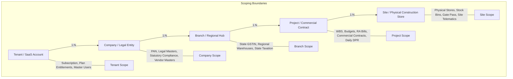

# DEZOBUILD — Domain Architecture & Canonical Model (v1)

```text
================================================================================
Document ID     : ARCH-DEZ-002
Milestone       : BACKEND ARCHITECTURE BASELINE v1
Status          : AUTHORITATIVE BASELINE — FROZEN FOR IMPLEMENTATION
Scope           : Construction OS Domain Model, Boundaries & Invariants
================================================================================
```

---

## 1. Canonical Tenancy & Enterprise Hierarchy

DEZOBUILD models enterprise construction operations across 5 distinct organizational tiers:



### 1.1 Organizational Boundary Definitions

1. **Tenant (`tenant_id`)**: The ultimate SaaS tenancy and billing boundary. Represents the enterprise customer subscription, master user directory, global configuration, and security root. Every database record in the tenant workspace contains `tenant_id`.
2. **Company / Legal Entity (`company_id`)**: The registered corporate entity holding PAN, CIN, corporate bank accounts, and legal vendor agreements. Used for statutory corporate billing, vendor master qualification, and corporate-level financial consolidations.
3. **Branch (`branch_id`)**: Regional office or state-level operational division holding state-specific GSTIN registrations, regional staff rosters, and regional distribution warehouses.
4. **Project (`project_id`)**: The commercial and operational contract boundary. Encapsulates project budgets, WBS work breakdown structure, daily DPRs, subcontractor work orders, contractor RA bills, and client billing claims.
5. **Site / Store (`site_id` / `store_id`)**: The physical geographical location where work occurs or materials are warehoused. Encapsulates physical inventory bin cards, gate entries, biometric turnstiles, and heavy machinery telemetry.

---

## 2. Exhaustive Domain Modules Breakdown

### 2.1 Identity & Access Management (IAM)
* **Responsibility**: User identity lifecycle, authentication, session tokens, password hashing, MFA, role assignments, and permission evaluation.
* **Aggregate Root**: `User`
* **Key Entities**: `Session`, `Role`, `Permission`, `UserRoleAssignment`, `ProjectMembership`, `PasswordResetToken`
* **Invariants**:
  * Every user must belong to at least one Tenant.
  * Role assignments within a tenant are restricted to the 9 authoritative customer roles.
  * `User <-> Employee` relationship is strictly **optional $1:0..1$** (site labourers or subcontractors may be Employee/Worker records without system login credentials; corporate auditors may be Users without HR employee master profiles).
  * JWT tokens are ephemeral session hints; server-side validation against `Session` and `UserRoleAssignment` is mandatory for all protected mutations.

---

### 2.2 Tenancy & Enterprise Master
* **Responsibility**: Organization structure, corporate legal entities, state GSTIN branches, site masters, and corporate departments.
* **Aggregate Root**: `Tenant`
* **Key Entities**: `Company`, `Branch`, `Site`, `Department`, `TenantSetting`, `ApiKey`, `WebhookSubscription`
* **Invariants**:
  * `Department` is a tenant-scoped configurable entity (e.g., Civil, MEP, Planning, Commercial, Quality, EHS).
  * A tenant cannot exceed its subscription limits on active projects or user seats.
  * Webhook subscriptions are signed using tenant-specific HMAC secrets.

---

### 2.3 Subscriptions & Plan Entitlements
* **Responsibility**: SaaS product tier definitions, capacity constraints, billing cycles, and feature flags.
* **Aggregate Root**: `TenantSubscription`
* **Key Entities**: `PlatformPlan` (Global Catalog), `PlanFeature`, `TenantEntitlementSnapshot`
* **Invariants**:
  * `PlatformPlan` catalog is platform-level and **decoupled** from tenant data.
  * Capacity limits enforced server-side:
    * **Starter Tier**: Max 2 active projects, 50 GB storage, 15 user seats.
    * **Professional Tier**: Max 10 active projects, 250 GB storage, 50 user seats.
    * **Enterprise Tier**: Unlimited active projects, 2 TB+ storage, unlimited seats.
  * Inactive or past-due subscriptions immediately restrict write mutations with `403 Forbidden (SUBSCRIPTION_SUSPENDED)` while preserving read access.

---

### 2.4 Projects, WBS & Progress Scheduling
* **Responsibility**: Capital projects register, Work Breakdown Structure hierarchy, milestone tracking, 2/4-week lookahead planning.
* **Aggregate Root**: `Project`
* **Key Entities**: `ProjectMember`, `WbsActivity`, `Milestone`, `LookaheadItem`, `SitePhotoGallery`
* **Invariants**:
  * WBS activities form a strict hierarchical tree (`parentId` referencing parent `WbsActivity`).
  * Root WBS categories conform to standard construction taxonomy: *Substructure, Superstructure, Finishes, MEP, External Works*.
  * Progress updates require both planned vs actual percentage ($0-100\%$) and quantity executed against planned baseline.
  * Archiving a project prevents new transactional mutations across all attached modules.

---

### 2.5 Progress & Daily Progress Reporting (DPR)
* **Responsibility**: Daily site execution telemetry, shift-wise workforce muster, equipment operating hours, material consumption, and photo documentation.
* **Aggregate Root**: `DprRecord`
* **Key Entities**: `DprManpower`, `DprEquipment`, `DprMaterial`, `DprProgressItem`, `DprPhoto`
* **Invariants**:
  * Only one DPR can be submitted per project per shift date.
  * DPR progresses through formal states: `DRAFT -> SUBMITTED -> APPROVED / REJECTED`.
  * Quantities claimed in approved DPRs feed directly into the WBS actual quantity ledger.
  * Photos require valid pre-signed S3 attachment metadata and GPS/timestamp telemetry.

---

### 2.6 Commercial & Cost Control
* **Responsibility**: Original baseline budget, revised estimates, committed costs, actual costs, Estimate at Completion (EAC), and variance tracking.
* **Aggregate Root**: `ProjectBudget`
* **Key Entities**: `CostHead`, `BudgetRevision`, `CommittedCostLedger`, `ActualCostLedger`, `VarianceAlertTrigger`
* **Invariants**:
  * $\text{Variance} = \text{Actual Cost} - \text{Planned Budget}$.
  * $\text{Committed Cost}$ automatically tallies approved POs + subcontracts not yet invoiced.
  * Budget revisions require formal `COMPANY_OWNER` or `COMPANY_ADMIN` approval before updating the baseline.

---

### 2.7 BOQ & Digital Measurement Book (MB)
* **Responsibility**: Bill of Quantities line items, physical site dimensional measurements ($L \times B \times D$, Area, Volume, Weight), measurement verification, and cumulative quantity ledgers.
* **Aggregate Root**: `BoqItem`
* **Key Entities**: `DigitalMbRecord`, `MeasurementDimension`, `MbVerificationLog`
* **Invariants**:
  * $\text{Cumulative Quantity} = \text{Previous Verified Quantity} + \text{Current Measurement Quantity}$.
  * Unverified Measurement Book entries **cannot** be linked to Contractor RA Bills or Client Claims.
  * Verification requires a distinct `SITE_ENGINEER` or `PROJECT_MANAGER` signature (`verifiedBy`, `verifiedAt`).

---

### 2.8 Materials Procurement & 3-Way Match GRN
* **Responsibility**: Site material indents, RFQ vendor quotes, Purchase Orders (PO), and Goods Receipt Notes (GRN) with 3-way match verification.
* **Aggregate Root**: `PurchaseOrder`
* **Key Entities**: `MaterialItem`, `MaterialIndent`, `IndentItem`, `PurchaseOrderItem`, `GrnRecord`, `GrnItem`
* **Invariants**:
  * $\text{Material Indent} \neq \text{Purchase Order} \neq \text{GRN} \neq \text{Vendor Invoice}$.
  * 3-Way Match verifies:
    $$\text{PO Quantity} \geq \text{GRN Received Quantity} = \text{Accepted Qty} + \text{Rejected Qty}$$
  * An approved GRN increases physical store stock balance, but does **not** automatically generate a cash payment.

---

### 2.9 Inventory & Warehouse Stock Ledger
* **Responsibility**: Store locations, stock balances, immutable physical stock ledgers, material store issues to WBS activities, returns, and inter-site stock transfers.
* **Aggregate Root**: `Store`
* **Key Entities**: `StockBalance`, `StockLedger`, `MaterialIssue`, `MaterialIssueItem`, `MaterialReturn`, `MaterialReturnItem`, `StockTransfer`, `StockTransferItem`
* **Invariants**:
  * **Immutable Dual-Entry Physical Stock Ledger**: Every movement creates a permanent `StockLedger` audit record with transaction type (`RECEIPT_GRN`, `ISSUE_WBS`, `TRANSFER_OUT`, `TRANSFER_IN`, `RETURN_SCRAP`, `RECONCILIATION_ADJUSTMENT`).
  * `StockTransferItem` is a **first-class child entity** of `StockTransfer` (supporting multi-item transfers in transit).
  * Negative stock is strictly disallowed under standard operational policy ($CurrentStock \geq 0$).
  * Inter-site transfers require atomic two-phase confirmation (`DISPATCHED` from Store A $\rightarrow$ `IN_TRANSIT` $\rightarrow$ `RECEIVED` at Store B).

---

### 2.10 Finance, Contractor RA Billing & Client Claims
* **Responsibility**: Site petty cash expense vouchers, subcontractor running account (RA) bills, statutory deductions (TDS, Labour Cess, Retention), client billing claims, vendor advances, and payment disbursement vouchers.
* **Aggregate Root**: `ContractorRaBill` / `ClientBillingClaim`
* **Key Entities**: `Expense`, `PaymentVoucher`, `Advance`, `AdvanceRecoveryLog`, `RetentionLedger`, `FinalBillSettlement`
* **Invariants**:
  * $\text{Net Payable} = \text{Gross Bill} - \text{Retention Amount} - \text{Advance Recovery} - \text{TDS} - \text{Labour Cess} - \text{Other Deductions}$.
  * Formal separation of financial lifecycle states:
    $$\text{DRAFT} \longrightarrow \text{SUBMITTED} \longrightarrow \text{VERIFIED} \longrightarrow \text{APPROVED} \longrightarrow \text{PAYABLE} \longrightarrow \text{PAID}$$
  * A bill or expense in `APPROVED` status is **not** paid. Payment requires an explicit, audited `PaymentVoucher` disbursement mutation with idempotency keys.
  * Final Bill closeout requires explicit `No Claim Certificate Received` boolean confirmation before closing contractor retention ledgers.

---

### 2.11 People, Attendance & Biometric Muster
* **Responsibility**: Employee directory, trade subcontractor gangs, daily biometric turnstile logs, manual muster corrections, and overtime calculation.
* **Aggregate Root**: `AttendanceRecord`
* **Key Entities**: `Employee`, `LabourContractor`, `AttendanceEntry`, `BiometricDeviceLog`, `WageImpactCalculation`
* **Invariants**:
  * Daily attendance entry captures `present | absent | half_day`, regular hours ($0-8$), and overtime hours ($0-8$).
  * Automatic wage impact calculation: $\text{Wage Impact} = (\text{Regular Hours} \times \text{Base Rate}) + (\text{OT Hours} \times \text{OT Rate})$.
  * Biometric hardware events are ingested via idempotent device telemetry endpoints and reconciled against daily project rosters.

---

### 2.12 Fleet, Heavy Machinery & Fuel Telematics
* **Responsibility**: Heavy machinery registry (Tower Cranes, Excavators, Concrete Pumps, Batching Plants, DG Sets), ownership classification (Owned vs Rented), runtime hour meters, fuel dispensing logs, and preventive maintenance tickets.
* **Aggregate Root**: `EquipmentAsset`
* **Key Entities**: `FuelLog`, `MaintenanceTicket`, `EquipmentOperator`, `EquipmentRentalContract`
* **Invariants**:
  * Cumulative operating hours are strictly monotonically increasing ($HourMeter_{new} \geq HourMeter_{previous}$).
  * Fuel dispensing logs require hour meter snapshot, quantity in liters, unit rate, and operator signature.
  * Maintenance tickets transition: `OPEN -> IN_PROGRESS -> COMPLETED`. Service completion resets next service hour countdown.

---

### 2.13 Quality Control (QA/QC) & Concrete Pour Cards
* **Responsibility**: Structural concrete pour cards, pre-pour multi-trade sign-off checklists (Shuttering, Rebar, Cover blocks, MEP inserts, Cleaning), Non-Conformance Reports (NCR), Root Cause Analysis, and CAPA corrective action plans.
* **Aggregate Root**: `PourCard` / `NcrRecord`
* **Key Entities**: `PourChecklist`, `NcrActionPlan`, `CapaVerificationLog`
* **Invariants**:
  * A Pour Card cannot be approved or marked `POURED` unless all 5 mandatory pre-pour checklist items are verified.
  * NCR severities: `minor`, `major`, `critical`. Critical NCRs emit high-priority alerts to the Project Manager and Quality Head.
  * Closure of an NCR requires both corrective action execution and formal verification by the QA/QC Engineer.

---

### 2.14 Safety & Environmental Health (EHS)
* **Responsibility**: Daily site safety walkthrough audits, PPE compliance percentages, hazard ratings, safety near-misses, first-aid logs, and lost-time incidents (LTI).
* **Aggregate Root**: `SafetyWalkthrough` / `SafetyIncident`
* **Key Entities**: `SafetyViolation`, `IncidentInvestigationLog`, `EhsActionItem`
* **Invariants**:
  * Safety inspections calculate a weighted PPE compliance score ($0-100\%$) and housekeeping score ($1-5$).
  * Safety incidents enforce classification: `near_miss | first_aid | medical_treatment | lost_time`.
  * Any `lost_time` incident triggers automated emergency alert escalation to Company Admin and Safety Director.

---

### 2.15 Documents, Drawings & Technical RFIs
* **Responsibility**: GFC drawing register, revision versioning, supersede locks, transmittals, technical Requests for Information (RFI), and formal engineering clarifications.
* **Aggregate Root**: `DrawingRecord` / `RfiRecord`
* **Key Entities**: `DrawingRevision`, `DocumentMetadata`, `RfiResponse`
* **Invariants**:
  * Uploading a new drawing revision automatically marks previous revisions as `SUPERSEDED`.
  * Only drawings marked `GFC` (Good for Construction) are eligible for site construction execution.
  * RFIs enforce response due dates and status transitions: `OPEN -> UNDER_REVIEW -> ANSWERED -> CLOSED`.

---

### 2.16 Policy-Driven Approval Engine
* **Responsibility**: Configurable multi-stage approval rules across transactional modules (`PO`, `Expense`, `Payment`, `GRN`, `DPR`, `Leave`, `RA Bill`).
* **Aggregate Root**: `ApprovalRule`
* **Key Entities**: `ApprovalStage`, `ApprovalRequest`, `ApprovalDecision`, `ApprovalDelegation`
* **Invariants**:
  * Approval thresholds are **dynamic policies** (e.g., Expense $> ₹50,000$ requires Project Manager; $> ₹500,000$ requires Company Owner).
  * **Segregation of Duties Enforcement**: The user who created or submitted a document **cannot** approve their own request unless an explicit single-user override policy is activated.
  * Approval decisions are immutable: once recorded (`APPROVED` / `REJECTED`), a decision cannot be modified.

---

### 2.17 Alerts, Analytics & Transactional Outbox
* **Responsibility**: Anomaly detection engine (cost overruns, schedule delays, low stock, idle machinery), scheduled reporting jobs, security audit trails, and reliable outbox message delivery.
* **Aggregate Root**: `SmartAlert` / `ReportExecution`
* **Key Entities**: `AlertRule`, `AlertOccurrence`, `AuditEvent`, `OutboxEvent`
* **Invariants**:
  * `ReportExecution` is a **first-class entity** managing asynchronous generation of heavy PDF/XLSX analytics exports.
  * `AuditEvent` records all authentication, authorization, financial, and master data changes with full actor, IP, timestamp, and delta snapshots.
  * `OutboxEvent` stores all domain events transactionally alongside aggregate state changes to guarantee at-least-once asynchronous delivery.
