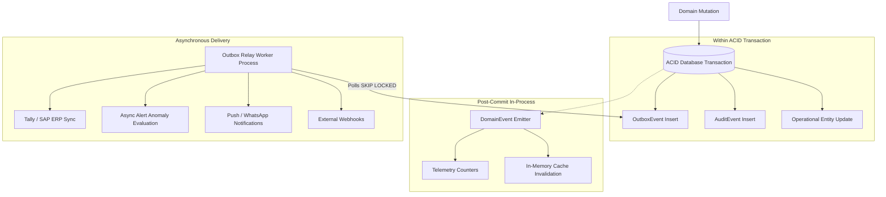

# DEZOBUILD — Transactional Event & Outbox Architecture (v1)

```text
================================================================================
Document ID     : ARCH-DEZ-007
Milestone       : BACKEND ARCHITECTURE BASELINE v1
Status          : AUTHORITATIVE BASELINE — FROZEN FOR IMPLEMENTATION
Scope           : Audit Trails, Domain Events, Transactional Outbox & Async Messaging
================================================================================
```

---

## 1. Tripartite Event Classification

DEZOBUILD strictly distinguishes three event paradigms according to persistence, lifecycle, and delivery guarantees:



### 1.1 Paradigm Definitions

| Event Paradigm | Persistence | Transaction Boundary | Delivery Guarantee | Intended Use Cases |
| :--- | :--- | :--- | :--- | :--- |
| **AuditEvent** | Permanent Table (`audit_events`) | Same ACID transaction | Guaranteed storage | Regulatory audits, security logs, financial action forensics, data delta history. |
| **DomainEvent** | Transient (In-Memory) | Post-commit lifecycle | Best-effort in-process | Local cache invalidation, telemetry metric increments, UI broadcast push. |
| **OutboxEvent** | Durable Queue (`outbox_events`)| Same ACID transaction | At-Least-Once Delivery | Customer webhooks, external integrations, email/SMS/WhatsApp dispatch, background jobs. |

---

## 2. Transactional Outbox Pattern Specification

To prevent dual-write vulnerabilities (e.g. database commits state change, but network failure aborts notification or webhook dispatch), all asynchronous communication is routed through a **Transactional Outbox Table**.

### 2.1 Outbox Schema & Status Transitions

```text
               +-------------------------------------------+
               |                  PENDING                  |
               +-------------------------------------------+
                                     |
                          Worker acquires lock
                     (SELECT ... FOR UPDATE SKIP LOCKED)
                                     v
               +-------------------------------------------+
               |                PROCESSING                 |
               +-------------------------------------------+
                                /          \
                        Success /            \ Network Error (Retry < 5)
                              /              v
                             /    +------------------------+
                            /     |   Backoff Scheduled    |
                           /      | (next_retry_at = t + Δ)|
                          /       +------------------------+
                         v                   |
               +-------------------+         | Exceeded Max Retries (5)
               |     PUBLISHED     |         v
               | (processed_at=now)|  +--------------------+
               +-------------------+  |       FAILED       |
                                      | (Dead-Letter Queue)|
                                      +--------------------+
```

### 2.2 Relational Outbox Table Definition

```sql
CREATE TABLE outbox_events (
    id UUID PRIMARY KEY DEFAULT gen_random_uuid(),
    tenant_id UUID NOT NULL REFERENCES tenants(id) ON DELETE CASCADE,
    aggregate_type VARCHAR(100) NOT NULL, -- e.g. PURCHASE_ORDER, RA_BILL, DPR
    aggregate_id VARCHAR(255) NOT NULL,
    event_type VARCHAR(100) NOT NULL,    -- e.g. po.issued, ra_bill.approved
    payload JSONB NOT NULL,
    idempotency_key VARCHAR(255) UNIQUE NOT NULL,
    status VARCHAR(50) DEFAULT 'PENDING' NOT NULL, -- PENDING, PROCESSING, PUBLISHED, FAILED
    retry_count INT DEFAULT 0 NOT NULL,
    next_retry_at TIMESTAMPTZ,
    processed_at TIMESTAMPTZ,
    error_message TEXT,
    created_at TIMESTAMPTZ DEFAULT NOW() NOT NULL
);

CREATE INDEX idx_outbox_pending ON outbox_events(status, next_retry_at) 
    WHERE status IN ('PENDING', 'PROCESSING');
CREATE INDEX idx_outbox_tenant_aggregate ON outbox_events(tenant_id, aggregate_type, aggregate_id);
```

### 2.3 Outbox Relay Worker Execution Logic

```typescript
// Architectural Worker Loop (Node.js Background Process)
async function processOutboxBatch(batchSize = 50) {
  const events = await prisma.$transaction(async (tx) => {
    // 1. Fetch and lock pending events, skipping currently locked rows
    const pending = await tx.$queryRaw<OutboxEvent[]>`
      SELECT * FROM outbox_events
      WHERE status = 'PENDING' AND (next_retry_at IS NULL OR next_retry_at <= NOW())
      ORDER BY created_at ASC
      LIMIT ${batchSize}
      FOR UPDATE SKIP LOCKED
    `;

    if (pending.length === 0) return [];

    // 2. Mark as processing
    const ids = pending.map((e) => e.id);
    await tx.$executeRaw`
      UPDATE outbox_events
      SET status = 'PROCESSING'
      WHERE id = ANY(${ids}::uuid[])
    `;

    return pending;
  });

  // 3. Dispatch each event to handlers
  for (const event of events) {
    try {
      await eventDispatcher.dispatch(event);
      
      // 4. Mark published on success
      await prisma.outboxEvent.update({
        where: { id: event.id },
        data: { status: "PUBLISHED", processedAt: new Date() }
      });
    } catch (err: any) {
      // 5. Exponential backoff retry logic
      const nextRetryCount = event.retryCount + 1;
      const isDead = nextRetryCount >= 5;
      const backoffDelaySeconds = Math.pow(4, nextRetryCount) * 15; // 15s, 60s, 240s, 960s...
      
      await prisma.outboxEvent.update({
        where: { id: event.id },
        data: {
          status: isDead ? "FAILED" : "PENDING",
          retryCount: nextRetryCount,
          nextRetryAt: isDead ? null : new Date(Date.now() + backoffDelaySeconds * 1000),
          errorMessage: err.message || "Unknown dispatch error"
        }
      });
    }
  }
}
```

---

## 3. Standard Event Schema & Domain Event Taxonomy

Every event payload strictly adheres to the standard CloudEvents-compatible JSON schema:

```json
{
  "eventId": "e9b5c2d3-1a2b-4c5d-6e7f-8a9b0c1d2e3f",
  "tenantId": "c1a2b3c4-d5e6-7f8a-9b0c-1d2e3f4a5b6c",
  "aggregateType": "PURCHASE_ORDER",
  "aggregateId": "po-uuid-12345",
  "eventType": "po.issued",
  "occurredAt": "2026-03-09T14:30:00.000Z",
  "actorId": "user-uuid-67890",
  "correlationId": "corr-uuid-abcdef",
  "idempotencyKey": "idem-uuid-99999",
  "payload": {
    "poNumber": "PO-BLR-2026-0042",
    "vendorId": "vendor-uuid-777",
    "vendorName": "Ultratech Cement Ltd",
    "projectId": "project-uuid-101",
    "grandTotal": 1450000.00,
    "itemsCount": 3
  }
}
```

### 3.1 Domain Event Catalog

| Domain | Event Type (`eventType`) | Triggering Action | Downstream Consumer Effects |
| :--- | :--- | :--- | :--- |
| **Projects** | `project.created` | New project provisioned | Capacity counter check; project folder provisioning. |
| **Projects** | `project.archived` | Project archived | Lock write APIs; archive active alerts. |
| **DPR** | `dpr.submitted` | Site Engineer submits DPR | Notify Project Manager for approval. |
| **DPR** | `dpr.approved` | PM approves DPR | Auto-update WBS executed quantities; evaluate delay anomalies. |
| **Materials** | `po.issued` | PO authorized | Vendor email transmittal with PDF attachment; commit budget cost. |
| **Materials** | `grn.verified` | 3-Way match completed | Increment physical stock balance; update PO received quantities. |
| **Inventory** | `stock.issued` | Material store issue | Decrement stock balance; update WBS material cost ledger. |
| **Inventory** | `stock.transferred` | Transfer dispatched | Decrement source store; notify receiving store. |
| **Finance** | `expense.approved` | Expense claim approved | Trigger petty cash payment workflow; update actual cost ledger. |
| **Finance** | `ra_bill.approved`| Subcontractor bill approved | Generate accounts payable voucher; compute retention hold. |
| **Finance** | `payment.disbursed`| Payout voucher executed | Post financial transaction; notify payee. |
| **Quality** | `ncr.opened` | Critical defect flagged | High-priority alert to PM & Quality Head. |
| **Safety** | `safety.incident_reported` | Near-miss / LTI logged | Emergency alert escalation to Company Admin. |
| **Alerts** | `alert.triggered` | Anomaly metric threshold breached | Real-time push notification & email digest. |
