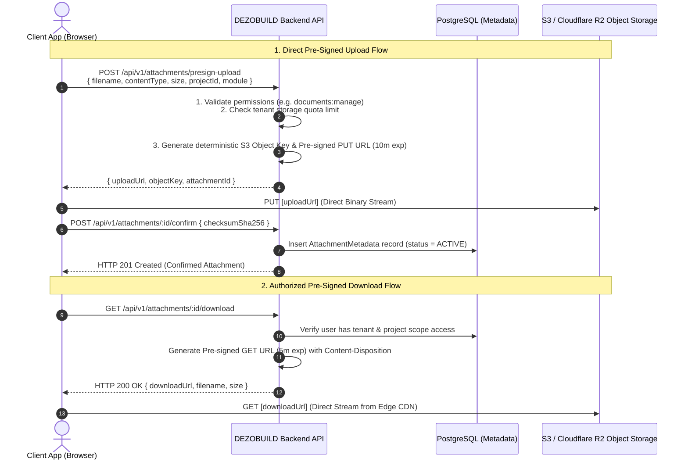

# DEZOBUILD — Object Storage & File Management Architecture (v1)

```text
================================================================================
Document ID     : ARCH-DEZ-008
Milestone       : BACKEND ARCHITECTURE BASELINE v1
Status          : AUTHORITATIVE BASELINE — FROZEN FOR IMPLEMENTATION
Scope           : S3 Object Storage, Pre-Signed URLs, Metadata Schema & Access Control
================================================================================
```

---

## 1. Storage Architecture & Principles

DEZOBUILD handles massive volumes of construction artifacts (high-resolution site progress photos, multi-megabyte CAD/BIM drawings, structural calculation PDFs, scanned invoices, and geotechnical test reports).



### 1.1 Non-Negotiable Storage Rules

1. **Zero Binary Storage in PostgreSQL**: The database stores **only** strongly typed metadata (UUID, object key, filename, mime type, byte size, SHA-256 checksum, uploader, timestamp). File streams never traverse the application server memory.
2. **Deterministic Multi-Tenant S3 Key Hierarchy**: Object keys are structured hierarchically to enforce tenant isolation and simplify storage lifecycle management:
   $$\text{tenants/}\{\text{tenant\_id}\}\text{/projects/}\{\text{project\_id}\}\text{/}\{\text{module}\}\text{/}\{\text{YYYY}\}\text{/}\{\text{MM}\}\text{/}\{\text{attachment\_id}\}\_\{\text{filename}\}$$
3. **Pre-Signed URL Security**:
   * Pre-signed `PUT` URLs expire in **10 minutes** and enforce exact `Content-Type` and `Content-Length-Range` constraints.
   * Pre-signed `GET` URLs expire in **5 minutes** and enforce authenticated authorization checks prior to generation.

---

## 2. Relational Attachment Metadata Schema

To avoid unsafe polymorphic relationships, file attachments use a centralized, strongly indexed `attachments` table linked via dedicated relation tables where relational integrity is critical:

```prisma
model Attachment {
  id              String      @id @default(uuid()) @db.Uuid
  tenantId        String      @db.Uuid
  projectId       String?     @db.Uuid
  module          String      @db.VarChar(50) // DPR, DRAWINGS, EXPENSES, QUALITY, SAFETY
  objectKey       String      @unique @db.VarChar(500)
  filename        String      @db.VarChar(255)
  fileExtension   String      @db.VarChar(20)
  mimeType        String      @db.VarChar(100)
  sizeBytes       BigInt
  checksumSha256  String      @db.VarChar(64)
  uploadedById    String      @db.Uuid
  status          String      @default("PENDING") @db.VarChar(50) // PENDING, ACTIVE, ARCHIVED, DELETED
  createdAt       DateTime    @default(now()) @db.Timestamptz
  confirmedAt     DateTime?   @db.Timestamptz
  deletedAt       DateTime?   @db.Timestamptz

  @@map("attachments")
  @@index([tenantId, projectId, module])
  @@index([tenantId, status])
}
```

---

## 3. Storage Quotas & Capacity Enforcement

Each SaaS subscription tier enforces strict storage thresholds:
* **Starter Tier**: 50 GB pooled storage
* **Professional Tier**: 250 GB pooled storage
* **Enterprise Tier**: 2 TB+ dedicated storage

Prior to issuing a pre-signed upload URL, the backend executes an atomic storage utilization check:

$$\sum (\text{sizeBytes of active attachments for tenant}) + \text{requested upload size} \le \text{Subscription Storage Limit}$$

If the threshold is breached, the API rejects the upload with `409 Conflict (STORAGE_QUOTA_EXCEEDED)` and prompts the customer to upgrade or archive legacy project artifacts.
