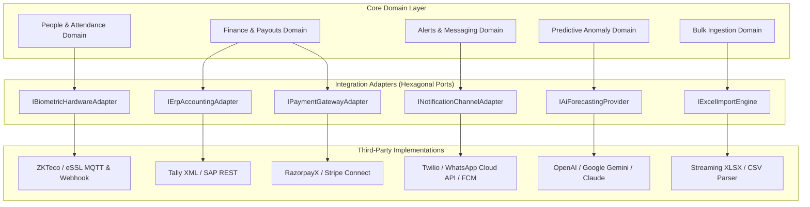
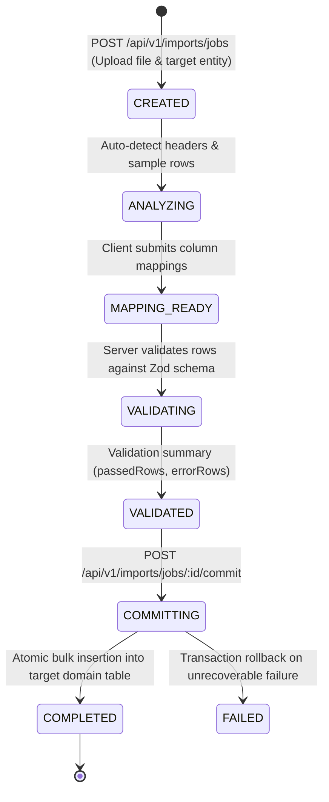

# DEZOBUILD — External Integration & Data Ingestion Architecture (v1)

```text
================================================================================
Document ID     : ARCH-DEZ-009
Milestone       : BACKEND ARCHITECTURE BASELINE v1
Status          : AUTHORITATIVE BASELINE — FROZEN FOR IMPLEMENTATION
Scope           : External Adapters, Biometrics, ERP, Payments, AI & Excel Import
================================================================================
```

---

## 1. External Integration Architecture & Provider Abstractions

To protect core domain logic from third-party vendor lock-in, all external communication is routed through **Strict Interface Adapters (Ports and Adapters Architecture)**.



---

## 2. Six External Integration Categories

### 2.1 Biometric Hardware & Turnstile Telemetry
* **Target Systems**: ZKTeco, eSSL, Realtime biometric fingerprint and facial turnstiles deployed at site gates.
* **Protocol**: HTTPS Webhook ingestion / MQTT edge broker gateway.
* **Boundary Rules**:
  * Raw punch logs are ingested into an immutable `biometric_raw_punches` staging buffer.
  * Punch events are deduplicated within a 5-minute sliding window per device/worker ID.
  * Reconciled daily against project staff rosters to produce authoritative `AttendanceRecord` entries.

---

### 2.2 ERP & Accounting (Tally & SAP)
* **Target Systems**: Tally Prime (XML / JSON Server), SAP S/4HANA (REST / OData).
* **Protocol**: Asynchronous export and webhook synchronization.
* **Boundary Rules**:
  * DEZOBUILD acts as the authoritative sub-ledger for site construction operations.
  * Finalized `PaymentVouchers`, `ContractorRaBills`, and `GrnRecords` generate standardized accounting payload snapshots for automated push to the general ledger.
  * Financial synchronization is idempotent using voucher UUID keys.

---

### 2.3 Payment Gateways (RazorpayX & Stripe)
* **Target Systems**: RazorpayX (India UPI/IMPS payouts), Stripe Connect.
* **Protocol**: REST API payout creation with HMAC-SHA256 signed webhook callbacks.
* **Boundary Rules**:
  * Payout mutations require mandatory `Idempotency-Key` headers.
  * Webhook handlers verify signatures before transitioning payment voucher status (`PENDING -> PAID` or `PENDING -> FAILED`).

---

### 2.4 SMS & WhatsApp Business Messaging
* **Target Systems**: Twilio, Gupshup, WhatsApp Cloud API.
* **Protocol**: Asynchronous Outbox Event Relay.
* **Boundary Rules**:
  * Automated transmittal of PO PDFs to vendors, OTP verification codes, and high-severity emergency safety alerts.

---

### 2.5 Push Notifications
* **Target Systems**: Firebase Cloud Messaging (FCM) & W3C Web Push Protocol.
* **Protocol**: Outbox Relay dispatcher.
* **Boundary Rules**:
  * Instant mobile/desktop push alerts for pending approval requests, critical NCR filings, and budget overrun warnings.

---

### 2.6 AI & Predictive Forecasting Abstraction
* **Target Systems**: Google Gemini / OpenAI / Anthropic Claude LLM engines.
* **Protocol**: Asynchronous worker execution with strict prompt containment.
* **Boundary Rules**:
  * **Zero Direct Domain Coupling**: Domain entities never invoke LLM APIs synchronously.
  * Anomaly metrics (schedule slippage, material consumption velocity) are analyzed asynchronously.
  * **AI suggestions are strictly advisory**: AI outputs (`predictedDelayDays`, `predictedOverrunAmount`, `suggestedAction`) are stored with model version and confidence scores and **never** mutate operational balances or approve transactions automatically.

---

## 3. Generic Excel / CSV Import Engine Architecture

The frozen frontend provides a comprehensive 6-step import wizard:
$$\text{Upload} \longrightarrow \text{Detect} \longrightarrow \text{Map Columns} \longrightarrow \text{Validate} \longrightarrow \text{Preview} \longrightarrow \text{Commit}$$

The backend architecture provides the corresponding server-side asynchronous execution pipeline:



### 3.1 Import Job Schema Specification

```prisma
model ImportJob {
  id              String      @id @default(uuid()) @db.Uuid
  tenantId        String      @db.Uuid
  targetEntity    String      @db.VarChar(50) // WBS, BOQ, MATERIALS, EMPLOYEES
  filename        String      @db.VarChar(255)
  storageKey      String      @db.VarChar(500)
  status          String      @default("CREATED") @db.VarChar(50) // CREATED, VALIDATING, VALIDATED, COMMITTING, COMPLETED, FAILED
  totalRows       Int         @default(0)
  validRows       Int         @default(0)
  errorRows       Int         @default(0)
  columnMappings  Json?       @db.JsonB
  validationErrors Json?      @db.JsonB // Array of { rowNumber, column, errorReason }
  requestedById   String      @db.Uuid
  createdAt       DateTime    @default(now()) @db.Timestamptz
  completedAt     DateTime?   @db.Timestamptz

  @@map("import_jobs")
  @@index([tenantId, targetEntity, status])
}
```
