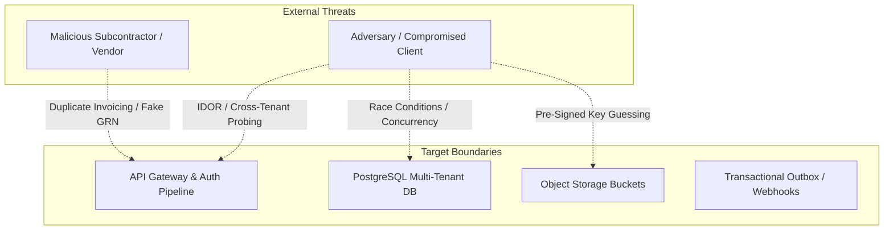

# DEZOBUILD — Threat Model & Security Defense Architecture (v1)

```text
================================================================================
Document ID     : ARCH-DEZ-010
Milestone       : BACKEND ARCHITECTURE BASELINE v1
Status          : AUTHORITATIVE BASELINE — FROZEN FOR IMPLEMENTATION
Scope           : STRIDE Security Analysis, Attack Mitigations & Verification
================================================================================
```

---

## 1. STRIDE Analysis & Security Posture

DEZOBUILD protects mission-critical commercial, financial, workforce, and structural compliance data across multi-tenant construction operations.



---

## 2. Exhaustive 18 Attack Vectors & Defense Matrix

| # | Attack Vector | Affected Component | Architectural Mitigation | Verification / Test Strategy |
| :--- | :--- | :--- | :--- | :--- |
| **01** | **Cross-Tenant IDOR** | All Repository queries & REST APIs | Tenant context is extracted exclusively from validated session; all SQL queries enforce `WHERE tenant_id = :contextTenantId`. | Automated negative tests querying another tenant's UUID returning `404 Not Found`. |
| **02** | **Project Scope Bypass** | Project-level mutations (`dpr`, `wbs`, `ra_bills`) | Scoping interceptor asserts user has explicit `ProjectMembership` or tenant-wide administrative scope. | Negative test: Non-assigned user mutating project returns `403 Forbidden`. |
| **03** | **Site/Store Scope Bypass** | Inventory mutations (`stock:issue`, `stock:transfer`) | Interceptor verifies user assignment to target `Store` before allowing stock decrement. | Negative test: Store keeper at Site A attempting issue at Site B is rejected. |
| **04** | **Privilege Escalation** | User & Role Assignment endpoints | Role assignment requires `settings:rbac:manage` permission; users cannot assign roles equal to or higher than their own. | Negative test: Project Manager assigning Company Admin role is blocked with `403`. |
| **05** | **Permission Bypass** | Protected API routes | Backend Permission Guard evaluates required namespace (e.g. `finance:expense:approve`) independent of frontend UI state. | Automated API test invoking mutation without permission returning `403`. |
| **06** | **Entitlement Bypass** | Premium feature routes & capacity endpoints | Entitlement Guard checks plan features and capacity limits (e.g. max active projects) server-side prior to execution. | Negative test: Starter plan tenant creating 3rd active project receives `409 Conflict`. |
| **07** | **SUPER_ADMIN Leakage** | Tenant operational data routes | `SUPER_ADMIN` token rejected on customer tenant operational routes (`/api/v1/projects`, `/api/v1/materials`). | Negative test: Platform token attempting customer data query returns `403 Forbidden`. |
| **08** | **Mass Assignment** | DTO parsing & Prisma mutations | Strict Zod validation schemas stripping unpermitted fields (`role`, `status`, `tenantId`, `balance`) before ORM updates. | Negative test: Submitting `{ role: "COMPANY_OWNER" }` during profile update is discarded. |
| **09** | **JWT Claim Tampering** | Edge Authentication Gateway | Cryptographically signed HMAC-SHA256 / RS256; claims treated as routing hints; database validates active session version. | Negative test: Forged/modified JWT signature immediately rejected with `401 Unauthorized`. |
| **10** | **Stolen Refresh Token** | Session Refresh endpoint | Refresh token rotation on every use; token family tracking immediately invalidates all sessions if reuse is detected. | Automated test: Replaying an old refresh token revokes the entire session chain. |
| **11** | **Session Replay** | Session Manager | Incremented `sessionVersion` on user password change, account suspension, or role revocation immediately invalidates active tokens. | Negative test: Active JWT rejected after password reset in parallel session. |
| **12** | **Duplicate Mutation** | Financial & Inventory mutations | Mandatory `Idempotency-Key` header with database unique constraint cache preventing duplicate execution within 24h. | Concurrency test: 10 parallel identical POSTs result in exactly 1 mutation and 9 cached responses. |
| **13** | **Inventory Race Condition** | Stock balance decrements | Row-level locking (`SELECT ... FOR UPDATE`) inside transaction; check constraint `current_stock >= 0`. | Concurrency test: 2 concurrent issues exceeding available stock cleanly rejects the 2nd with `409`. |
| **14** | **Payment Double-Spending** | Payout voucher disbursement | Unique constraint on `PaymentVoucher.idempotencyKey` + database row-level locking during banking integration call. | Concurrency test: Parallel disbursement calls result in exactly 1 payment. |
| **15** | **Unauthorized File Access** | S3 download endpoints | No public S3 bucket access; pre-signed `GET` URLs generated only after authenticating user project access (expires in 5m). | Direct S3 bucket access rejected with `403 AccessDenied`. |
| **16** | **S3 Key Guessing** | Pre-signed URL Generator | High-entropy UUID v4 attachment identifiers with deterministic tenant prefix hierarchy; direct enumeration impossible. | Penetration test: Guessing random object key paths yields zero data. |
| **17** | **Webhook Spoofing** | Payment & Biometric callbacks | Inbound webhooks validated via HMAC-SHA256 signatures using tenant/provider specific shared secrets before parsing. | Negative test: Webhook payload with invalid HMAC signature rejected with `401 Unauthorized`. |
| **18** | **Audit Log Tampering** | Audit & Stock Ledgers | `audit_events` and `stock_ledgers` tables have zero `UPDATE` or `DELETE` API endpoints or application write paths. | Database permission test: ORM has no update/delete access on ledger models. |
