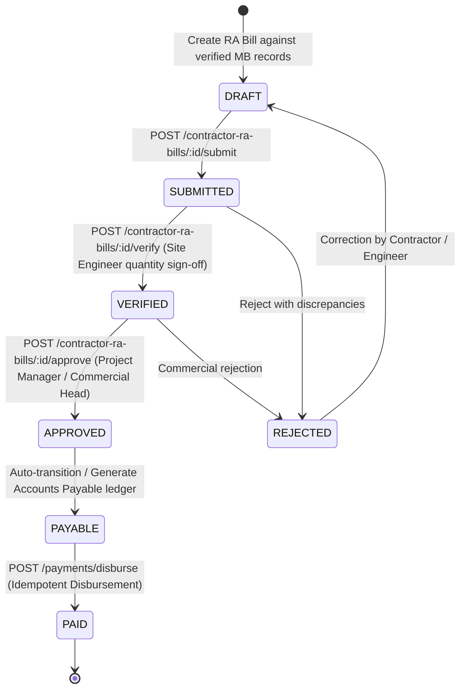
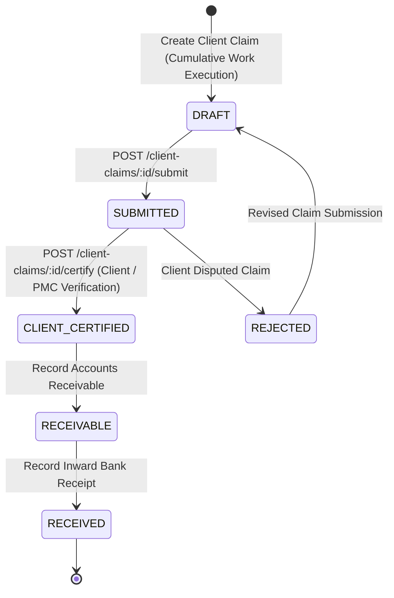
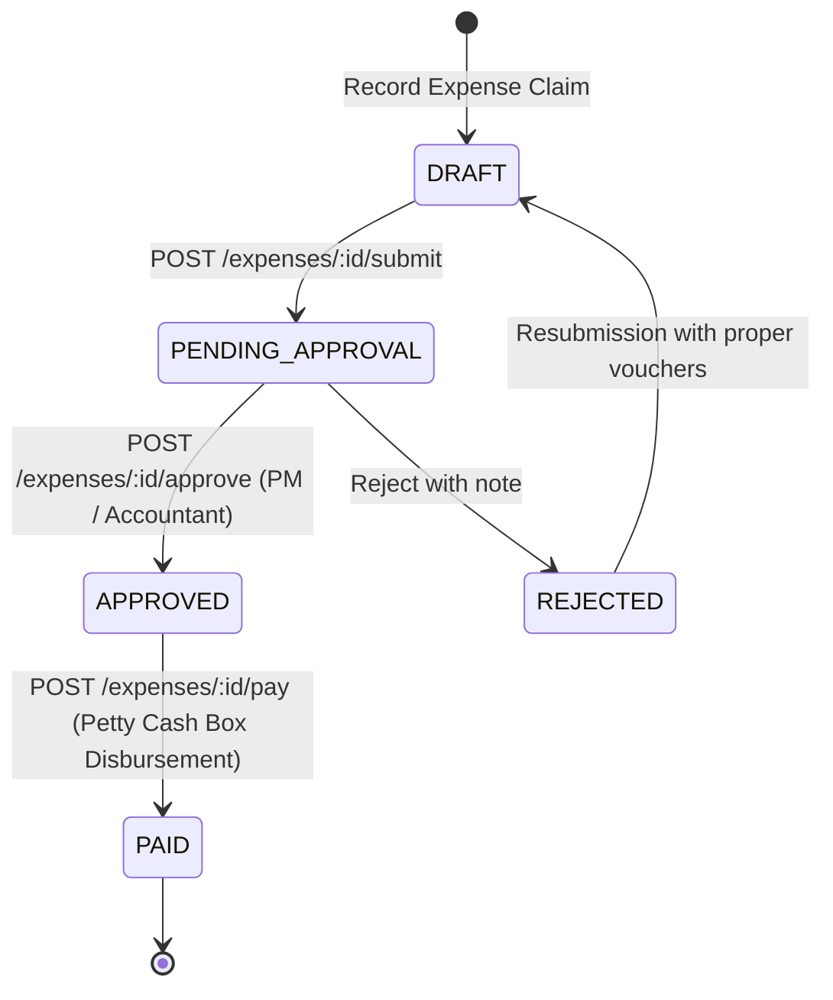
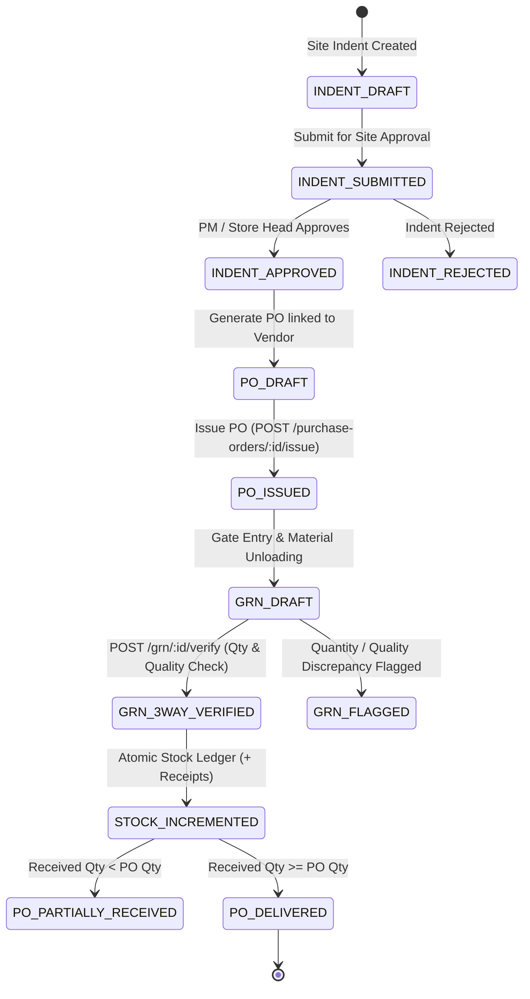
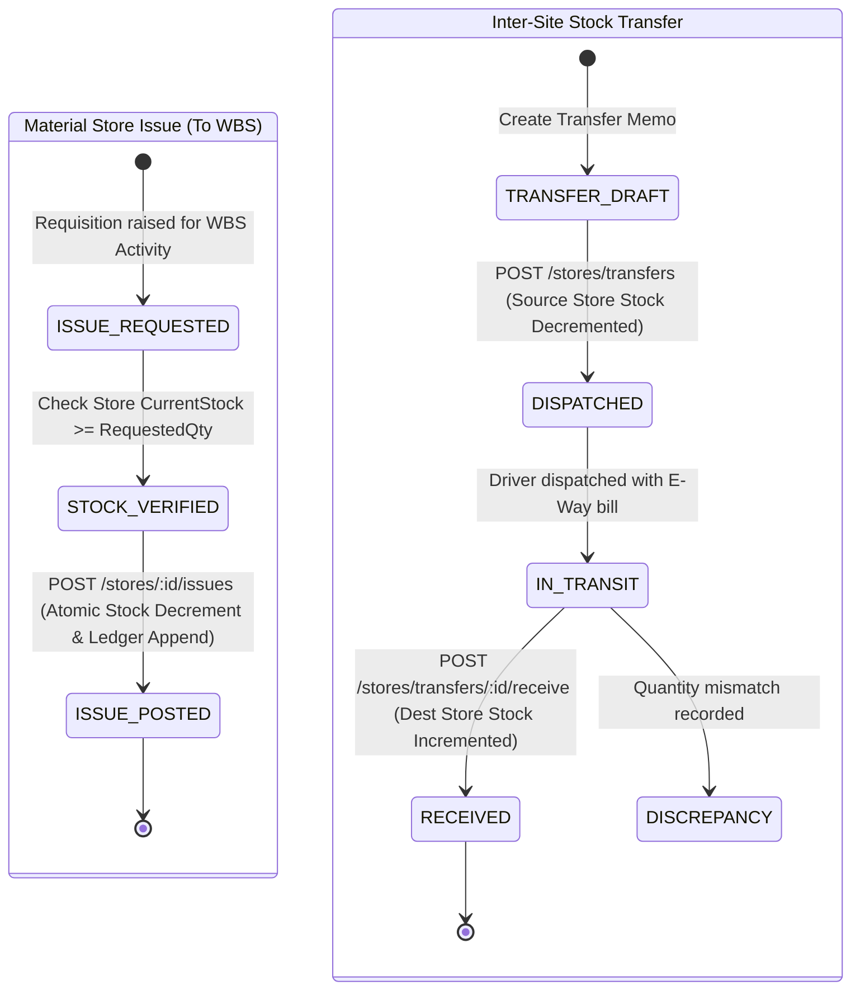
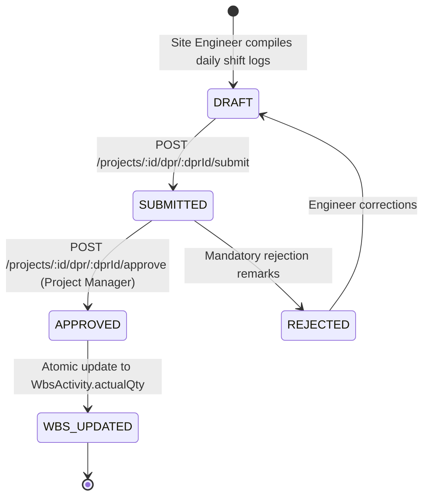
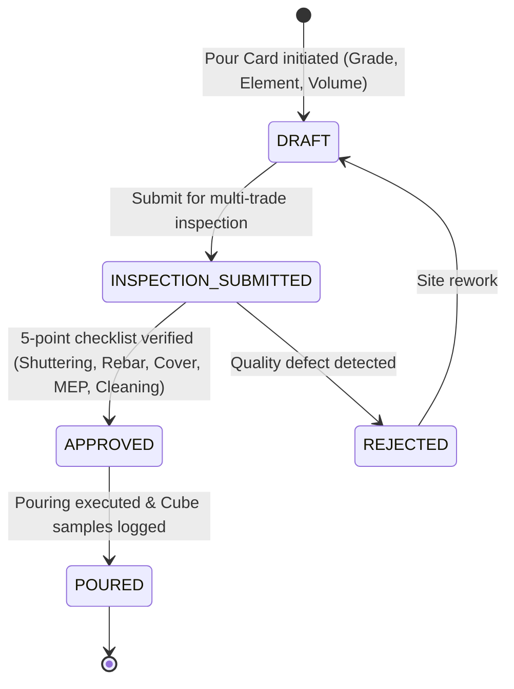
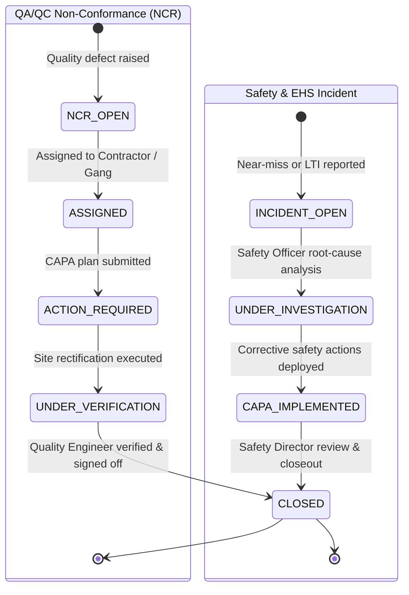
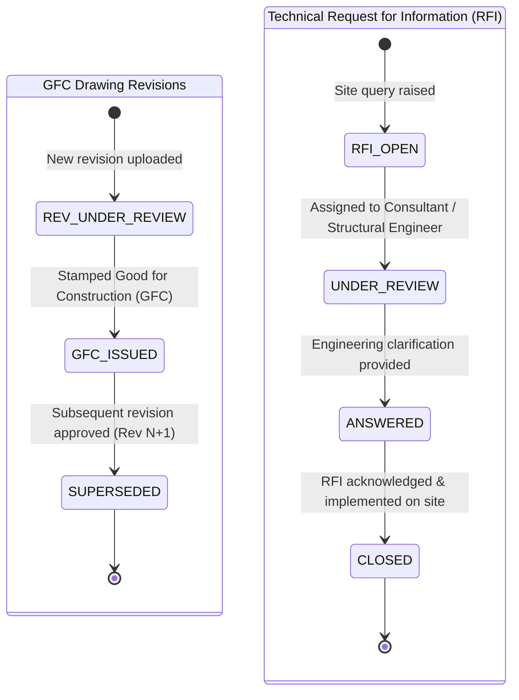
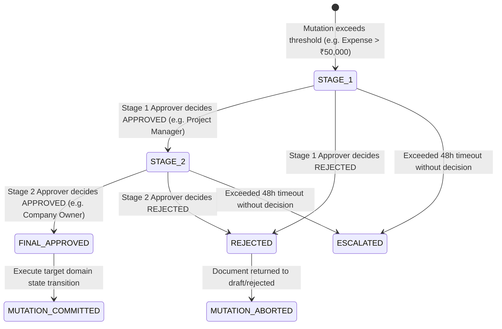

# DEZOBUILD — Operational Workflow State Machines (v1)

```text
================================================================================
Document ID     : ARCH-DEZ-006
Milestone       : BACKEND ARCHITECTURE BASELINE v1
Status          : AUTHORITATIVE BASELINE — FROZEN FOR IMPLEMENTATION
Scope           : State Machine Lifecycles, Invariants & Transition Rules
================================================================================
```

---

## 1. Core Financial & Commercial Lifecycles

### 1.1 Multi-Stage Contractor RA Billing State Machine



#### Transition Invariants:
* **Measurement Binding**: An RA bill cannot be created unless linked to `verified` Digital Measurement Book entries.
* **Statutory Calculation Integrity**: Deductions ($\text{Retention } 5\%$, $\text{TDS } 2\%$, $\text{Labour Cess } 1\%$, $\text{Advance Recovery}$) are calculated automatically on Gross Bill amount.
* **Approved $\neq$ Paid**: An `approved` or `payable` RA bill records a liability. Cash only leaves the account upon audited execution of `POST /api/v1/payments/disburse`.

---

### 1.2 Client Billing & Certification State Machine



---

### 1.3 Site Petty Cash Expense State Machine



---

## 2. Procurement, Inventory & Stock Movement Lifecycles

### 2.1 Material Indent to Purchase Order to 3-Way Match GRN



#### 3-Way Match Verification Invariants:
1. **Quantity Verification**: $\text{Ordered Qty (PO)} \ge \text{Received Qty (Challan)} = \text{Accepted Qty} + \text{Rejected Qty}$.
2. **Atomic Ledger Posting**: Transitioning GRN to `verified` atomically increases `StockBalance.currentStock` at the target `Store` and appends an immutable `StockLedger` row of type `RECEIPT_GRN`.
3. **No Automatic Payment**: A verified GRN creates no payment voucher. Payment is authorized only after invoice matching by the `ACCOUNTANT`.

---

### 2.2 Store Material Issue & Inter-Site Stock Transfer



---

## 3. Project, Progress (DPR) & Technical Lifecycles

### 3.1 Daily Progress Report (DPR) State Machine



---

### 3.2 Concrete Pour Card State Machine



---

### 3.3 Non-Conformance Report (NCR) & Safety Incident Lifecycles



---

### 3.4 GFC Drawings & Technical RFI Lifecycles



---

## 4. Policy-Driven Multi-Stage Approval Engine



#### Segregation of Duties Rules:
1. `Creator != Approver`: The user who authored the initial document is strictly prevented from approving any stage of the workflow.
2. `Single-Approver Override`: If configured by enterprise policy on low-value items ($<\text{₹}5,000$), single-step approval is permitted.
