# DEZOBUILD — Entity-Relationship Schema & Database Architecture

## Overview

This document specifies the database entity relationships and relational data model for the **DEZOBUILD** Construction Operating System.

```mermaid
erDiagram
    PROJECT ||--o{ WBS_ACTIVITY : contains
    PROJECT ||--o{ DPR_RECORD : logs
    PROJECT ||--o{ MATERIAL_INDENT : requisitions
    PROJECT ||--o{ PURCHASE_ORDER : issues
    PROJECT ||--o{ GRN_RECORD : receives
    PROJECT ||--o{ MATERIAL_ISSUE : consumes
    PROJECT ||--o{ EXPENSE_RECORD : incurs
    PROJECT ||--o{ PAYMENT_RECORD : pays
    PROJECT ||--o{ ATTENDANCE_RECORD : musters
    PROJECT ||--o{ DOCUMENT_ITEM : stores
    PROJECT ||--o{ SMART_ALERT : triggers

    MATERIAL_ITEM ||--o{ GRN_ITEM : received_in
    MATERIAL_ITEM ||--o{ ISSUE_ITEM : issued_in
    MATERIAL_ITEM ||--o{ INDENT_ITEM : requested_in

    VENDOR ||--o{ PURCHASE_ORDER : supplied_by
    VENDOR ||--o{ PAYMENT_RECORD : paid_to
    CONTRACTOR ||--o{ MATERIAL_ISSUE : issued_to
    CONTRACTOR ||--o{ ATTENDANCE_RECORD : supplied_by

    EQUIPMENT_ASSET ||--o{ FUEL_LOG : consumes
    EQUIPMENT_ASSET ||--o{ MAINTENANCE_RECORD : serviced_in
```

---

## Entity Descriptions

### 1. Core Projects (`projects`)

- Primary record representing a construction site or infrastructure package.
- Attributes: `code`, `name`, `client_name`, `contract_value`, `estimated_budget`, `actual_cost`, `progress_percent`, `planned_progress`, `built_up_area_sq_ft`.

### 2. Work Breakdown Structure (`wbs_activities`)

- Discrete work packages and milestones per project.
- Attributes: `wbs_code`, `name`, `category`, `planned_quantity`, `actual_quantity`, `unit`, `weightage_percent`, `progress_percent`, `status`.

### 3. Daily Progress Reports (`dpr_records`)

- Daily site telemetry captured by site engineers.
- Attributes: `dpr_number`, `date`, `submitted_by`, `weather`, `total_labour`, `labour_breakdown`, `activity_progress`, `materials_consumed`, `equipment_utilized`, `site_issues`, `photos`.

### 4. Materials Master & Inventory (`materials`)

- Central materials inventory catalog.
- Attributes: `item_code`, `name`, `category`, `current_stock`, `reorder_level`, `safety_stock`, `unit_rate`, `total_stock_value`, `warehouse_location`, `status`.

### 5. Financial Ledgers (`expenses`, `payments`, `advances`)

- Accounts payable, site petty cash, and milestone disbursements.
- Attributes: `voucher_number`, `category`, `amount`, `beneficiary`, `payment_mode`, `status`.

### 6. Workforce & Attendance (`employees`, `attendance_records`)

- Headcount, trade allocations, and contractor muster logs.
- Attributes: `own_staff_present`, `contract_labour_present`, `trade_muster`, `shift`, `recorded_by`.

### 7. Fleet & Equipment (`equipment`, `fuel_logs`, `maintenance_records`)

- Plant and machinery telematics and uptime.
- Attributes: `asset_code`, `ownership`, `status`, `total_hours_run`, `fuel_consumption`, `maintenance_tickets`.
