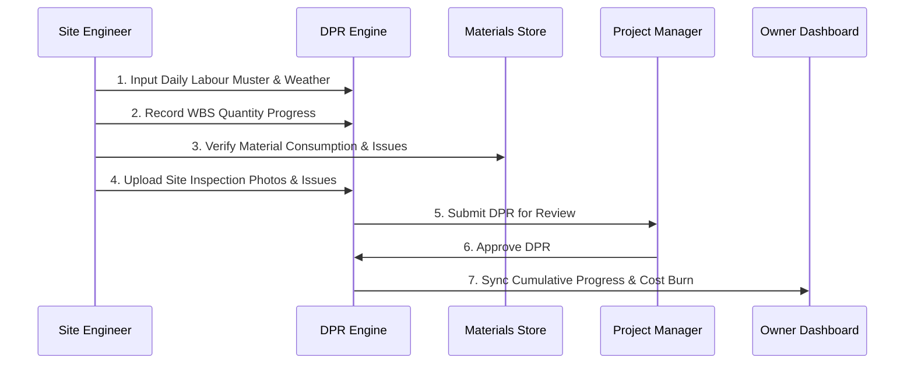
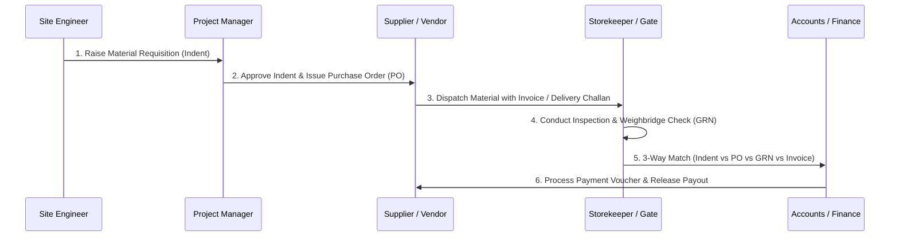

# DEZOBUILD — Operational Workflows & Standard Operating Procedures

## 1. Daily Site Operations Lifecycle (DPR & Telemetry)

---

## 2. Procurement & 3-Way Match Verification Lifecycle

---

## 3. Exception & Smart Alert Escalation Lifecycle

1. **Trigger Condition**: WBS activity delay > 3 days, actual cost > 10% budget variance, or material stock < safety stock.
2. **Alert Broadcast**: Dispatched directly to the DEZOBUILD top nav indicator and Alerts module.
3. **Acknowledgment**: Field engineer / PM reviews site constraints and flags acknowledgment.
4. **Resolution**: Corrective action executed on site (e.g. material replenishment, gang reallocation) and marked resolved with timestamped site notes.
